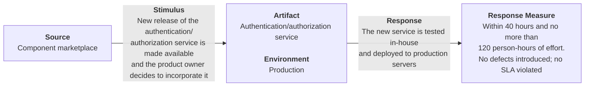
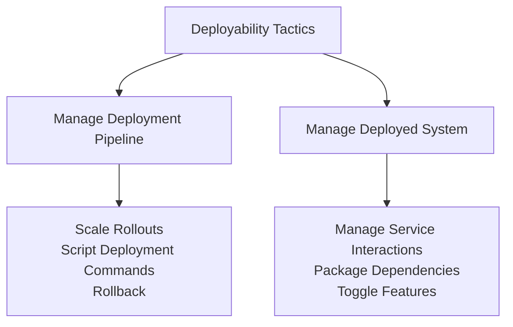
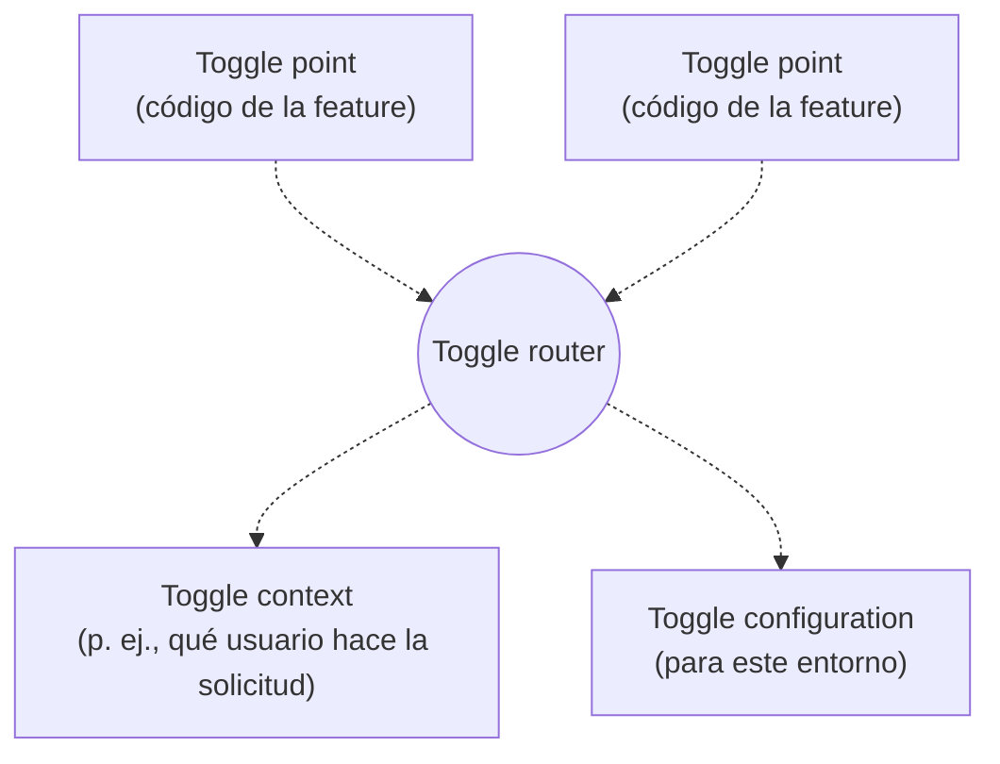
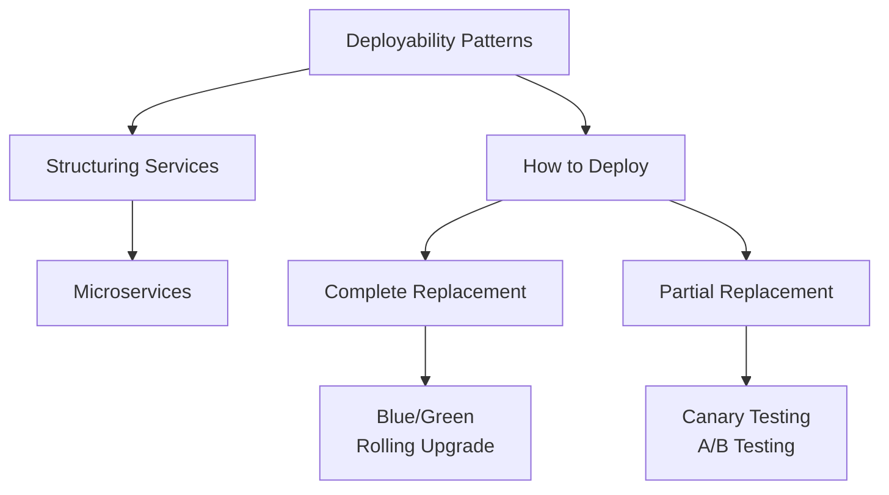
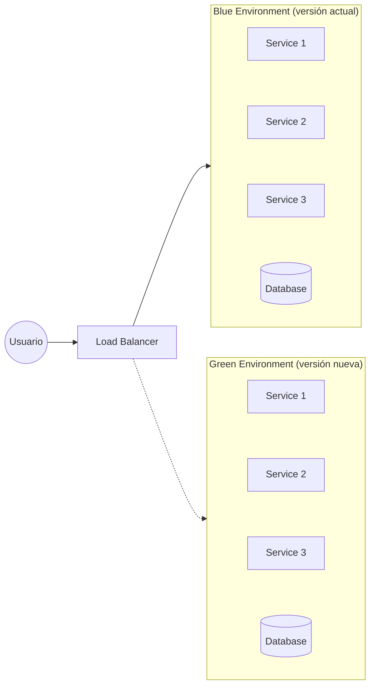
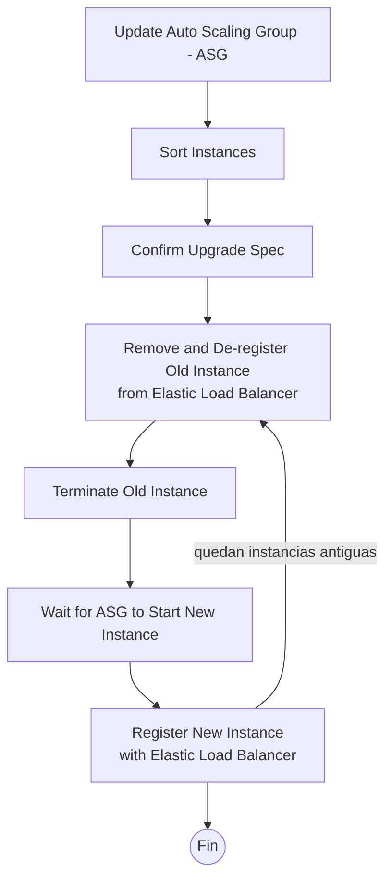
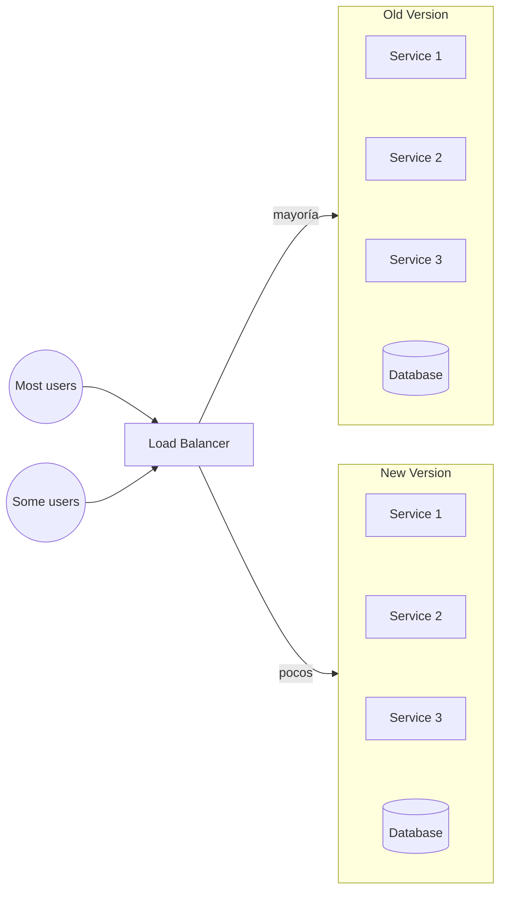

# Desplegabilidad (Deployability)

## Importancia

En los "viejos tiempos", los *releases* eran poco frecuentes: una gran cantidad de cambios se agrupaban en liberaciones programadas. Un release contenía nuevas funcionalidades y correcciones de errores. Era común tener un release por mes, por trimestre o incluso por año. Las presiones competitivas en muchos dominios, con el comercio electrónico a la cabeza, generaron la necesidad de ciclos de lanzamiento mucho más cortos.

En estos contextos, las liberaciones pueden ocurrir en cualquier momento, posiblemente cientos de veces al día, y cada una puede ser realizada por un equipo diferente dentro de la organización. Poder publicar con frecuencia significa que, en particular, las correcciones de errores no tienen que esperar al próximo lanzamiento programado, sino que pueden publicarse tan pronto como se descubre y corrige un error.

## Definición

La **desplegabilidad** es una propiedad del software que indica que puede desplegarse, es decir, asignarse a un entorno para su ejecución, dentro de una cantidad de tiempo y esfuerzo **predecible y aceptable**. Además, si el nuevo despliegue no cumple con sus especificaciones, puede **revertirse**, también dentro de una cantidad de tiempo y esfuerzo predecible y aceptable.

El atributo de calidad de **capacidad de prueba** (*testability*) juega sin duda un papel fundamental en el despliegue continuo, y el arquitecto puede dar un soporte crítico al despliegue continuo garantizando que el sistema sea comprobable.

## Retos en el despliegue de software

- ¿Cómo llega el software a su host? Por *push* (las actualizaciones se despliegan sin que nadie las solicite) o por *pull* (los usuarios o administradores deben solicitarlas explícitamente).
- ¿Cómo se integra en un sistema existente? ¿Se puede hacer mientras el sistema existente está en ejecución?
- ¿Cuál es el medio: DVD, unidad USB o entrega por Internet?
- ¿Cuál es el paquete (p. ej., ejecutable, aplicación, *plugin*)?
- ¿Cuál es la integración resultante en el sistema existente?
- ¿Qué tan eficiente es el proceso? ¿Qué tan controlable es?

Los arquitectos se preocupan principalmente por el grado en que la arquitectura soporta despliegues que sean:

- **Granulares:** los despliegues pueden ser de todo el sistema o de elementos dentro de él. Si la arquitectura ofrece opciones de despliegue más granulares, se pueden reducir ciertos riesgos.
- **Controlables:** la arquitectura debe permitir desplegar en diferentes niveles de granularidad, monitorear el funcionamiento de las unidades desplegadas y revertir los despliegues fallidos.
- **Eficientes:** la arquitectura debe soportar un despliegue rápido (y, si es necesario, un *rollback*) con un nivel de esfuerzo razonable.

# Escenario

## Escenario general

| Portion of Scenario | Description | Possible Values |
|---|---|---|
| **Source** | The trigger for the deployment. | End user, developer, system administrator, operations personnel, component marketplace, product owner. |
| **Stimulus** | What causes the trigger. | A new element is available to be deployed. This is typically a request to replace a software element with a new version (e.g., fix a defect, apply a security patch, upgrade to the latest release of a component or framework, upgrade to the latest version of an internally produced element). New element is approved for incorporation. An existing element/set of elements needs to be rolled back. |
| **Artifacts** | What is to be changed. | Specific components or modules, the system's platform, its user interface, its environment, or another system with which it interoperates. Thus the artifact might be a single software element, multiple software elements, or the entire system. |
| **Environment** | Staging, production (or a specific subset of either). | Full deployment. Subset deployment to a specified portion of users, VMs, containers, servers, platforms. |
| **Response** | What should happen. | Incorporate the new components. Deploy the new components. Monitor the new components. Roll back a previous deployment. |
| **Response measure** | A measure of cost, time, or process effectiveness for a deployment, or for a series of deployments over time. | Cost in terms of: number, size, and complexity of affected artifacts; average/worst-case effort; elapsed clock or calendar time; money (direct outlay or opportunity cost); new defects introduced. Extent to which this deployment/rollback affects other functions or quality attributes. Number of failed deployments. Repeatability of the process. Traceability of the process. Cycle time of the process. |

## Ejemplo de un escenario concreto

> Se publica una nueva versión del servicio de autenticación/autorización en el *marketplace* de componentes y el *product owner* decide incorporarla. El nuevo servicio se prueba internamente y se despliega en los servidores de producción en menos de 40 horas y con no más de 120 horas-persona de esfuerzo, sin introducir defectos y sin violar ningún SLA.

# Tácticas

Las tácticas de desplegabilidad, en muchos casos, son proporcionadas al menos en parte por una infraestructura de **CI/CD** (integración continua / despliegue continuo) que se compra en lugar de construirse. En ese caso, el trabajo del arquitecto suele ser **elegir y evaluar** (en lugar de implementar) las tácticas de despliegue correctas y la combinación correcta de ellas.

Fuente: *Software Architecture in Practice, 4th Edition*

# Tácticas - Manage Deployment Pipeline

**Lanzamientos escalonados (Scale rollouts)**

En lugar de desplegar a toda la base de usuarios, los lanzamientos escalonados despliegan una nueva versión de un servicio gradualmente, a subconjuntos controlados de la población de usuarios, a menudo sin notificarles explícitamente. (El resto de usuarios sigue usando la versión anterior del servicio). Al lanzar de forma gradual, los efectos del nuevo despliegue pueden monitorearse y medirse y, si es necesario, revertirse. Esta táctica minimiza el posible impacto negativo de desplegar un servicio defectuoso. Requiere un mecanismo arquitectónico (que no forma parte del servicio que se despliega) para enrutar la solicitud de un usuario al servicio nuevo o al antiguo, según la identidad de ese usuario.

**Revertir (Rollback)**

Si se descubre que un despliegue tiene defectos o no cumple con las expectativas del usuario, puede "revertirse" a su estado anterior. Como los despliegues pueden implicar múltiples actualizaciones coordinadas de varios servicios y sus datos, el mecanismo de reversión debe poder hacer seguimiento de todas ellas, o debe poder revertir las consecuencias de cualquier actualización hecha por un despliegue, idealmente de manera totalmente automatizada.

**Programar los comandos de despliegue (Script deployment commands)**

Los despliegues suelen ser complejos y requieren muchos pasos que deben ejecutarse y orquestarse con precisión. Por eso, el despliegue suele estar automatizado mediante *scripts*. Estos scripts deben tratarse como código: documentados, revisados, probados y con control de versiones. Un motor de *scripting* ejecuta el script de despliegue automáticamente, ahorrando tiempo y minimizando las oportunidades de error humano.

# Tácticas - Manage Deployed System

**Gestionar las interacciones entre servicios (Manage service interactions)**

Esta táctica permite el despliegue y la ejecución simultánea de múltiples versiones de los servicios del sistema. Varias solicitudes de un cliente pueden dirigirse a cualquiera de las versiones en cualquier orden. Sin embargo, tener varias versiones del mismo servicio en funcionamiento puede generar incompatibilidades de versión. En esos casos, las interacciones entre servicios deben ser mediadas para evitar de forma proactiva dichas incompatibilidades. Esta táctica es una estrategia de gestión de recursos que evita la necesidad de replicar completamente los recursos para desplegar por separado las versiones antigua y nueva.

**Empaquetar dependencias (Package dependencies)**

Esta táctica empaqueta un elemento junto con sus dependencias para que se desplieguen juntos y para que las versiones de las dependencias sean coherentes a medida que el elemento pasa de desarrollo a producción. Las dependencias pueden incluir bibliotecas, versiones del sistema operativo y contenedores de utilidades (por ejemplo, *sidecar*, *service mesh*). Tres formas de empaquetar dependencias son usar **contenedores**, **pods** o **máquinas virtuales**.

**Interruptores de funcionalidad (Feature toggle)**

Incluso cuando el código está completamente probado, es posible encontrar problemas después de desplegar nuevas funcionalidades. Por eso conviene integrar un "interruptor de apagado" (*kill switch*, o *feature toggle*) para las nuevas funcionalidades. El interruptor desactiva una funcionalidad del sistema en tiempo de ejecución, sin obligar a iniciar un nuevo despliegue. Esto da la capacidad de controlar las funcionalidades desplegadas sin el costo y el riesgo de volver a desplegar los servicios.

- Se ponen **toggle points** en el código para cambiar el comportamiento de la nueva funcionalidad.
- Varios toggle points de la misma funcionalidad usan un único **toggle router** para determinar su estado.
- El toggle router puede necesitar considerar el **toggle context** (p. ej., qué usuario hace la solicitud) para tomar una decisión de enrutamiento.
- El toggle router se controla mediante la **toggle configuration** de cada entorno.

Fuente: [Martin Fowler – Feature Toggles (Feature Flags)](https://martinfowler.com/articles/feature-toggles.html)

# Patrones de desplegabilidad

Los patrones de despliegue se organizan en dos categorías:

1. Patrones para **estructurar los servicios** que se desplegarán.
2. Patrones sobre **cómo desplegar** los servicios, que se dividen en dos subcategorías: **reemplazo completo** (todo o nada) o **reemplazo parcial**.

## Structuring Services - Microservicios

El patrón de arquitectura de microservicios estructura el sistema como una colección de servicios **desplegables de forma independiente** que se comunican **solo mediante mensajes** a través de interfaces de servicio. No se permite ninguna otra forma de comunicación entre procesos: sin enlaces directos, sin lecturas directas del almacén de datos de otro equipo, sin modelo de memoria compartida, sin puertas traseras de ningún tipo. Los servicios generalmente no tienen estado (*stateless*) y, como los desarrolla un solo equipo relativamente pequeño, son relativamente pequeños; de ahí el término *microservicio*. Las dependencias entre servicios son **acíclicas**. Una parte integral de este patrón es un **servicio de descubrimiento** (*service discovery*) para que los mensajes puedan enrutarse adecuadamente.

**Beneficios**

- Se reduce el tiempo de salida al mercado (*time to market*). Como cada servicio es pequeño y se puede desplegar de forma independiente, una modificación de un servicio se puede desplegar sin coordinarse con los equipos dueños de otros servicios.
- Cada equipo puede elegir sus propias tecnologías para su servicio, siempre que admitan el paso de mensajes. No se necesita coordinación sobre versiones de bibliotecas o lenguajes de programación. Esto reduce los errores por incompatibilidades que surgen durante la integración.
- Los servicios escalan más fácilmente que las aplicaciones de granularidad más gruesa. Como cada servicio es independiente, agregar instancias dinámicamente es sencillo. Así, la oferta del servicio puede adaptarse más fácilmente a la demanda.

**Tradeoffs**

- La sobrecarga aumenta, en comparación con la comunicación en memoria, porque toda la comunicación entre servicios ocurre mediante mensajes a través de la red. Esto se puede mitigar en parte con el patrón de **service mesh**, que obliga a desplegar algunos servicios en el mismo host para reducir el tráfico de red. Además, por la naturaleza dinámica de los despliegues de microservicios, los servicios de descubrimiento se usan mucho, lo que aumenta la sobrecarga. Esos servicios de descubrimiento pueden terminar convirtiéndose en un cuello de botella de rendimiento.
- Los microservicios son menos adecuados para transacciones complejas, por la dificultad de sincronizar actividades entre sistemas distribuidos.
- La libertad de cada equipo para elegir su propia tecnología tiene un costo: la organización debe mantener esas tecnologías y la experiencia necesaria.
- El control intelectual del sistema completo puede ser difícil por la gran cantidad de microservicios. Esto introduce la necesidad de catálogos y bases de datos de interfaces. Además, combinar adecuadamente los servicios para lograr el resultado deseado puede ser complejo y sutil.
- Diseñar los servicios para que tengan las responsabilidades adecuadas y un nivel de granularidad apropiado es una tarea de diseño formidable.
- Para poder desplegar versiones de forma independiente, la arquitectura de los servicios debe diseñarse para permitir esa estrategia de despliegue.

> Organizaciones que han usado mucho el patrón de microservicios: Google, Netflix, PayPal, Twitter, Facebook y Amazon.

## Complete Replacement of Services (Reemplazo completo)

Suponga que hay **N instancias** del Servicio A y quiere reemplazarlas con N instancias de una nueva versión del Servicio A, sin dejar instancias de la versión original. Quiere hacerlo sin reducir la calidad del servicio para sus clientes, por lo que siempre debe haber N instancias en ejecución.

### Blue/Green

Se crean N nuevas instancias del servicio, cada una con el nuevo Servicio A (llamémoslas instancias **verdes**). Después de instalar las N instancias nuevas, el servidor DNS o el servicio de descubrimiento se cambia para apuntar a la nueva versión. Una vez que se determina que las nuevas instancias funcionan satisfactoriamente, entonces y solo entonces se eliminan las N instancias del Servicio A original (las **azules**). Antes de ese punto, si se encuentra un problema en la nueva versión, basta con volver a los servicios azules, con poca o ninguna interrupción.

> El load balancer apunta a un solo entorno a la vez. Al cambiar de versión, se redirige todo el tráfico del entorno azul al verde.

### Rolling Upgrade (Actualización gradual)

Una actualización gradual reemplaza las instancias del Servicio A por instancias de la nueva versión **una a la vez**. (En la práctica se puede reemplazar más de una a la vez, pero solo una pequeña fracción en cada paso). Los pasos son:

1. Asignar recursos para una nueva instancia del Servicio A (por ejemplo, una máquina virtual).
2. Instalar y registrar la nueva versión del Servicio A.
3. Empezar a dirigir solicitudes a la nueva versión del Servicio A.
4. Elegir una instancia del Servicio A antiguo, dejar que complete cualquier procesamiento activo y luego destruirla.
5. Repetir los pasos anteriores hasta reemplazar todas las instancias de la versión anterior.

**Rolling upgrade implementado por la herramienta Asgard de Netflix:**

**Comparación visual**

| Blue/green deployment | Rolling upgrade deployment |
|---|---|
| El load balancer apunta a un grupo completo de instancias (azules) mientras existe un segundo grupo completo (verdes) listo para recibir el tráfico. | El load balancer apunta a un solo grupo de instancias, que se van reemplazando una por una. |

**Beneficios**

- Permiten reemplazar completamente las versiones desplegadas de los servicios sin poner el sistema fuera de servicio, lo que **aumenta la disponibilidad** del sistema.

**Tradeoffs**

- **Uso de recursos:** el uso máximo de recursos en blue/green es de **2N** instancias, mientras que en rolling upgrade es de **N + 1**. En cualquier caso, hay que adquirir los recursos para alojarlas. Antes de la adopción generalizada de la nube, adquirir significaba comprar: la organización tenía que comprar computadores físicos para hacer la actualización. Como la mayor parte del tiempo no había ninguna actualización en curso, esos computadores adicionales quedaban casi siempre inactivos, por lo que el rolling upgrade era el enfoque estándar. Ahora que los recursos se pueden alquilar bajo demanda, el tradeoff financiero es menos determinante, pero sigue existiendo.
- **Errores latentes:** a pesar de todas las pruebas en los entornos de desarrollo, integración y *staging*, al desplegar en producción todavía puede haber errores latentes. Con blue/green, cuando se descubre el error es posible que ya se hayan eliminado todas las instancias originales, y volver a la versión anterior podría tomar bastante tiempo. En cambio, un rolling upgrade puede permitir descubrir el error mientras todavía hay instancias de la versión anterior disponibles.
- **Versiones simultáneas:** desde la perspectiva del cliente, con blue/green en cualquier momento está activa la versión nueva o la anterior, pero no ambas. Con rolling upgrade, **ambas versiones están activas al mismo tiempo**. Esto introduce dos tipos de problemas:
  - **Inconsistencia temporal (*temporal inconsistency*):** en una secuencia de solicitudes del Cliente C al Servicio A, algunas pueden ser atendidas por la versión anterior y otras por la nueva. Si las versiones se comportan diferente, el Cliente C puede producir resultados erróneos o, al menos, inconsistentes. (Se puede prevenir con la táctica de **gestionar las interacciones entre servicios**).
  - **Desajuste de interfaz (*interface mismatch*):** si la interfaz de la nueva versión del Servicio A es diferente de la anterior, las invocaciones de clientes que no se han actualizado producirán resultados impredecibles. Se puede evitar **extendiendo** la interfaz sin modificar la existente, y usando el **patrón mediador** para traducir de la interfaz extendida a una interfaz interna que produzca el comportamiento correcto.

## Partial Replacement of Service (Reemplazo parcial)

A veces no es deseable cambiar todas las instancias de un servicio. Los patrones de despliegue parcial buscan ofrecer múltiples versiones de un servicio simultáneamente para diferentes grupos de usuarios. Se usan para fines como control de calidad (**canary testing**) y pruebas de marketing (**A/B testing**).

### Canary Testing

Antes de lanzar una nueva versión, es prudente probarla en el entorno de producción, pero con un conjunto limitado de usuarios. Canary testing designa a un **pequeño grupo de usuarios** que probarán la nueva versión. A veces estos probadores son los llamados usuarios avanzados (*power users*) o usuarios de versiones preliminares (*preview stream*) de fuera de la organización, que tienen más probabilidad de ejercitar rutas de código y casos extremos que los usuarios típicos usan con menos frecuencia. Los usuarios pueden saber o no que están siendo usados como conejillos de indias, es decir, como "canarios". Otro enfoque es usar probadores dentro de la organización que desarrolla el software.

**Beneficios**

- Permite que usuarios reales "exploten" el software de formas que las pruebas simuladas no pueden. Así, la organización puede recopilar datos "en uso" y hacer experimentos controlados con un riesgo relativamente bajo.
- Tiene costos de desarrollo adicionales mínimos, porque el sistema que se prueba va camino a producción de todos modos.
- Minimiza la cantidad de usuarios que pueden quedar expuestos a un defecto grave en el nuevo sistema.

**Tradeoffs**

- Requiere planificación y recursos adicionales por adelantado, y es necesario formular una estrategia para evaluar los resultados de las pruebas.
- Si las pruebas canary están dirigidas a usuarios avanzados, hay que identificarlos y enrutarles la nueva versión.

### A/B Testing

Los equipos de marketing usan las pruebas A/B para hacer un experimento con usuarios reales y determinar cuál de varias alternativas produce los mejores resultados de negocio. Un número pequeño pero significativo de usuarios recibe un trato diferente al resto. La diferencia puede ser menor, como un cambio en el tamaño de la fuente o en el diseño de un formulario, o más significativa. Al igual que en canary testing, los servidores DNS y el servicio de descubrimiento se configuran para enviar las solicitudes de los clientes a diferentes versiones. En las pruebas A/B, se monitorean las versiones para ver cuál ofrece la mejor respuesta desde una **perspectiva comercial**.

**Beneficios**

- Permite a los equipos de marketing y de producto hacer experimentos y recopilar datos de usuarios reales.
- Permite seleccionar usuarios con base en un conjunto arbitrario de características.

**Tradeoffs**

- Requiere implementar alternativas, de las cuales una será descartada.
- Las diferentes clases de usuarios y sus características deben identificarse por adelantado.

# Lecturas recomendadas

- [Feature Toggles – Martin Fowler](https://martinfowler.com/articles/feature-toggles.html)
- [From Big Bang to Canary – Medium (ByteByteGo)](https://medium.com/bytebytego-system-design-alliance/from-big-bang-to-canary-exploring-software-deployment-strategies-for-a-flawless-release-with-3610e89ea789)

# Bibliografía

Len Bass, Paul Clements, Rick Kazman. *Software Architecture in Practice*. 4th Edition. SEI / Addison-Wesley, 2022.