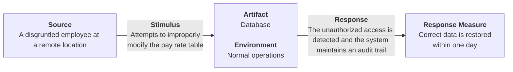
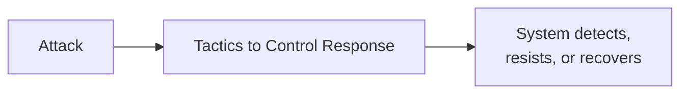
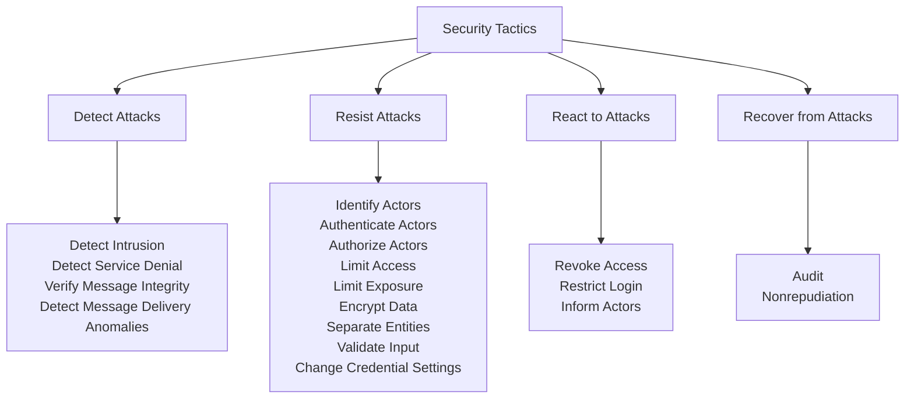
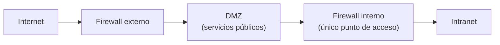
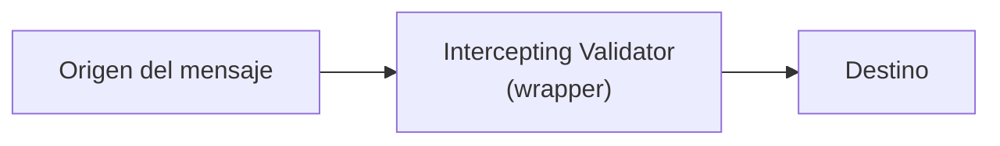

# Seguridad (Security)

## Definición

La **seguridad** es una medida de la capacidad del sistema para proteger los datos y la información del acceso no autorizado y, al mismo tiempo, proporcionar acceso a las personas y los sistemas que están autorizados.

Un **ataque**, es decir, una acción realizada contra un sistema informático con la intención de causar daño, puede tomar varias formas. Puede tratarse de un intento no autorizado de acceder a datos o servicios o de modificar datos, o puede tener la intención de denegar servicios a usuarios legítimos.

## Confidencialidad, Integridad y Disponibilidad (CIA)

El enfoque más simple para caracterizar la seguridad se centra en tres características:

- **Confidencialidad:** la propiedad de que los datos o servicios están protegidos contra el acceso no autorizado. Por ejemplo, un pirata informático no puede acceder a sus declaraciones de impuestos sobre la renta en una computadora del gobierno.
- **Integridad:** la propiedad de que los datos o servicios no están sujetos a manipulación no autorizada. Por ejemplo, su calificación no ha cambiado desde que su instructor la asignó.
- **Disponibilidad:** la propiedad de que el sistema estará disponible para un uso legítimo. Por ejemplo, un ataque de denegación de servicio no le impedirá pedir un libro en una librería en línea.

## Privacidad

Un tema muy relacionado con la seguridad es la calidad de la **privacidad**. Las preocupaciones sobre la privacidad se han vuelto más importantes en los últimos años y están consagradas en la ley en la Unión Europea a través del **Reglamento General de Protección de Datos (GDPR)**. Otras jurisdicciones han adoptado regulaciones similares.

Lograr la privacidad se trata de limitar el acceso a la información, lo que a su vez se trata de **qué** información debe tener acceso limitado y **a quién** se le debe permitir el acceso. El término general para la información que debe mantenerse privada es **información de identificación personal (PII)**.

El **NIST** (Instituto Nacional de Estándares y Tecnología) define la PII como:

> "Cualquier información sobre una persona mantenida por una agencia, incluida (1) cualquier información que pueda usarse para distinguir o rastrear la identidad de una persona, como nombre, número de seguro social, fecha y lugar de nacimiento, apellido de soltera de la madre o registros biométricos; y (2) cualquier otra información que esté vinculada o pueda vincularse a un individuo, como información médica, educativa, financiera y laboral."

**Notas adicionales (del orador)**

- La pregunta de **quién** puede acceder a estos datos es más complicada. Los usuarios suelen aceptar acuerdos de privacidad que detallan quién, fuera de la organización que recolecta los datos, puede ver la PII. La propia organización también debe tener políticas sobre quién puede acceder a ella internamente.
- Ejemplo: un *tester* necesita datos realistas para probar un sistema. ¿Esos datos incluyen PII? Generalmente, la PII se oculta (se ofusca) para fines de prueba.
- Con frecuencia se le pide al arquitecto, quizás en nombre del gerente del proyecto, que verifique que la PII esté oculta para los miembros del equipo de desarrollo que no necesitan acceder a ella.

# Escenario

## Escenario general

| Portion of Scenario | Description | Possible Values |
|---|---|---|
| **Source** | The attack may be from outside the organization or from inside the organization. The source of the attack may be either a human or another system. It may have been previously identified (either correctly or incorrectly) or may be currently unknown. | Human; Another system which is: inside the organization, outside the organization, previously identified, unknown. |
| **Stimulus** | The stimulus is an attack. | An unauthorized attempt to: display data, capture data, change or delete data, access system services, change the system's behavior, reduce availability. |
| **Artifacts** | What is the target of the attack? | System services; Data within the system; A component or resources of the system; Data produced or consumed by the system. |
| **Environment** | What is the state of the system when the attack occurs? | The system is: online or offline; connected to or disconnected from a network; behind a firewall or open to a network; fully operational; partially operational; not operational. |
| **Response** | The system ensures that confidentiality, integrity, and availability are maintained. | **Transactions are carried out in a fashion such that:** data or services are protected from unauthorized access; data or services are not being manipulated without authorization; parties to a transaction are identified with assurance; the parties to the transaction cannot repudiate their involvements; the data, resources, and system services will be available for legitimate use. **The system tracks activities within it by:** recording access or modification; recording attempts to access data, resources, or services; notifying appropriate entities (people or systems) when an apparent attack is occurring. |
| **Response measure** | Measures of a system's response are related to the frequency of successful attacks, the time and cost to resist and repair attacks, and the consequential damage of those attacks. | One or more of the following: how much of a resource is compromised or ensured; accuracy of attack detection; how much time passed before an attack was detected; how many attacks were resisted; how long it takes to recover from a successful attack; how much data is vulnerable to a particular attack. |

## Ejemplo de un escenario concreto

> Un empleado descontento en una ubicación remota intenta modificar incorrectamente la tabla de tasas de pago durante las operaciones normales. Se detecta el acceso no autorizado, el sistema mantiene un registro de auditoría y los datos correctos se restauran en un día.

# Tácticas

Un método para pensar en cómo lograr la seguridad en un sistema es centrarse en la **seguridad física**. Las instalaciones seguras:

- Solo permiten un **acceso limitado** a ellas (p. ej., mediante vallas y puntos de control de seguridad).
- Tienen medios para **detectar** intrusos (p. ej., exigiendo que los visitantes legítimos lleven insignias).
- Tienen mecanismos de **disuasión** (p. ej., guardias armados).
- Tienen capacidad de **reacción** (p. ej., cierre automático de puertas).
- Tienen mecanismos de **recuperación** (p. ej., copia de seguridad fuera del sitio).

Esto conduce a las cuatro categorías de tácticas: ***detectar, resistir, reaccionar y recuperarse***.

## Tácticas de seguridad

Fuente: *Software Architecture in Practice, 4th Edition*

# Tácticas - Detectar ataques (Detect Attacks)

**Detectar intrusión (Detect intrusion)**

Esta táctica compara el tráfico de red o los patrones de solicitud de servicios dentro de un sistema con un conjunto de firmas o patrones conocidos de comportamiento malicioso almacenados en una base de datos. Las firmas se pueden basar en las características del protocolo, las características de la solicitud, los tamaños de la carga útil, las aplicaciones, la dirección de origen o destino o el número de puerto.

**Detectar denegación de servicio (Detect service denial)**

Esta táctica compara el patrón o la firma del tráfico de red que ingresa a un sistema con perfiles históricos de ataques de denegación de servicio (DoS) conocidos.

**Verificar la integridad del mensaje (Verify message integrity)**

Esta táctica emplea técnicas como sumas de verificación (*checksums*) o valores *hash* para verificar la integridad de los mensajes, archivos de recursos, archivos de despliegue y archivos de configuración. Una suma de verificación es un mecanismo de validación en el que el sistema mantiene por separado información redundante para archivos y mensajes, y utiliza esta información redundante para verificar el archivo o mensaje. Un valor hash es una cadena única generada por una función hash, cuya entrada puede ser archivos o mensajes. Incluso un ligero cambio en los archivos o mensajes originales da como resultado un cambio significativo en el valor hash.

**Detectar anomalías en la entrega de mensajes (Detect message delivery anomalies)**

Esta táctica busca detectar posibles ataques de intermediario (*man-in-the-middle*), en los que una parte malintencionada intercepta (y posiblemente modifica) los mensajes. Si los tiempos de entrega de mensajes son normalmente estables, al verificar el tiempo que lleva entregar o recibir un mensaje es posible detectar un comportamiento de tiempo sospechoso. Del mismo modo, un número anormal de conexiones y desconexiones puede indicar un ataque de este tipo.

# Tácticas - Resistir ataques (Resist Attacks)

**Identificar actores (Identify actors)**

La identificación de actores (usuarios o computadoras remotas) se enfoca en identificar la fuente de cualquier entrada externa al sistema. Los usuarios generalmente se identifican a través de IDs de usuario. Otros sistemas pueden ser "identificados" a través de códigos de acceso, direcciones IP, protocolos, puertos o algún otro medio.

**Autenticar actores (Authenticate actors)**

La autenticación significa garantizar que un actor es realmente quien o lo que pretende ser. Las contraseñas, las contraseñas de un solo uso, los certificados digitales, la autenticación de dos factores y la identificación biométrica proporcionan un medio para la autenticación. Otro ejemplo es **CAPTCHA** (*Completely Automated Public Turing test to tell Computers and Humans Apart*), un tipo de prueba de desafío-respuesta que se utiliza para determinar si el usuario es humano. Los sistemas pueden requerir una reautenticación periódica, como cuando su teléfono inteligente se bloquea automáticamente después de un período de inactividad.

**Autorizar actores (Authorize actors)**

Autorización significa garantizar que un actor autenticado tiene los derechos para acceder y modificar datos o servicios. Este mecanismo generalmente se habilita al proporcionar algunos mecanismos de control de acceso dentro de un sistema. El control de acceso se puede asignar por actor, por clase de actor o por rol.

**Limitar el acceso (Limit access)**

Esta táctica consiste en limitar el acceso a los recursos informáticos. Limitar el acceso puede significar restringir la cantidad de puntos de acceso a los recursos o restringir el tipo de tráfico que puede pasar a través de los puntos de acceso. Ambos tipos de límites minimizan la **superficie de ataque** de un sistema.

Por ejemplo, una **zona desmilitarizada (DMZ)** se usa cuando una organización quiere permitir que los usuarios externos accedan a ciertos servicios pero no a otros. La DMZ se encuentra entre Internet y una intranet, y está protegida por un par de firewalls, uno a cada lado. El firewall interno es un único punto de acceso a la intranet; funciona como un límite para el número de puntos de acceso y controla el tipo de tráfico permitido hacia la intranet.

**Limitar la exposición (Limit exposure)**

Esta táctica se enfoca en minimizar los efectos del daño causado por una acción hostil. Es una **defensa pasiva**, ya que no evita de forma proactiva que los atacantes hagan daño. La limitación de la exposición generalmente se realiza al reducir la cantidad de datos o servicios a los que se puede acceder a través de un único punto de acceso y que, por lo tanto, se verían comprometidos en un solo ataque.

**Cifrar datos (Encrypt data)**

La confidencialidad generalmente se logra aplicando alguna forma de cifrado a los datos y a la comunicación. El cifrado brinda protección adicional a los datos almacenados de manera persistente, más allá de la que ofrece la autorización. Los enlaces de comunicación, en comparación, pueden no tener controles de autorización. En tales casos, el cifrado es la única protección para pasar datos a través de enlaces de comunicación de acceso público. El cifrado puede ser **simétrico** (lectores y escritores usan la misma clave) o **asimétrico** (lectores y escritores usan pares de claves pública y privada).

**Separar entidades (Separate entities)**

La separación de diferentes entidades limita el alcance de un ataque. La separación dentro del sistema se puede realizar a través de la separación física en diferentes servidores conectados a diferentes redes, el uso de máquinas virtuales o un "espacio de aire" (*air gap*), es decir, no tener una conexión electrónica entre las diferentes partes de un sistema. Finalmente, los datos confidenciales se separan con frecuencia de los datos no confidenciales para reducir la posibilidad de ataques por parte de los usuarios que tienen acceso a datos no confidenciales.

**Validar entrada (Validate input)**

Limpiar y verificar la entrada a medida que la recibe un sistema, o parte de un sistema, es una importante línea de defensa inicial para resistir los ataques. Esto a menudo se implementa mediante el uso de un *framework* de seguridad o una clase de validación para realizar acciones como el filtrado, la canonicalización y la sanitización de la entrada. La validación de datos es la principal forma de defensa contra ataques como la **inyección SQL**, en la que se inserta código malicioso en sentencias SQL, y el **cross-site scripting (XSS)**, en el que código malicioso proveniente de un servidor se ejecuta en un cliente.

**Cambiar la configuración de credenciales (Change credential settings)**

Muchos sistemas tienen configuraciones de seguridad predeterminadas asignadas cuando se entrega el sistema. Obligar al usuario a cambiar esa configuración evitará que los atacantes obtengan acceso al sistema a través de configuraciones que pueden estar disponibles públicamente. De manera similar, muchos sistemas requieren que los usuarios elijan una nueva contraseña después de un período de tiempo máximo.

# Tácticas - Reaccionar a ataques (React to Attacks)

**Revocar el acceso (Revoke access)**

Si el sistema o un administrador del sistema cree que se está produciendo un ataque, el acceso a recursos confidenciales puede limitarse severamente, incluso para usuarios y usos normalmente legítimos. Por ejemplo, si su computador fue comprometido por un virus, su acceso a ciertos recursos puede estar limitado hasta que elimine el virus de su sistema.

**Restringir el inicio de sesión (Restrict login)**

Los intentos fallidos repetitivos de inicio de sesión pueden indicar un posible ataque. Muchos sistemas limitan el acceso desde una computadora en particular si hay repetidos intentos fallidos de acceder a una cuenta desde esa computadora. Por supuesto, los usuarios legítimos pueden cometer errores al intentar iniciar sesión, por lo que el acceso limitado puede durar solo un cierto período de tiempo. En algunos casos, los sistemas duplican el período de bloqueo después de cada intento fallido.

**Informar a los actores (Inform actors)**

Los ataques en curso pueden requerir la acción de operadores, otro personal o sistemas cooperantes. Dicho personal o sistemas (el conjunto de actores relevantes) deben ser notificados cuando el sistema ha detectado un ataque.

# Tácticas - Recuperarse de ataques (Recover from Attacks)

**Auditoría (Audit)**

Auditamos los sistemas, es decir, mantenemos un registro de las acciones del usuario y del sistema y sus efectos, para ayudar a rastrear las acciones de un atacante e identificarlo. Podemos analizar las pistas de auditoría para intentar enjuiciar a los atacantes o crear mejores defensas en el futuro.

**No repudio (Nonrepudiation)**

Esta táctica garantiza que el remitente de un mensaje no pueda negar posteriormente haber enviado el mensaje y que el destinatario no pueda negar haberlo recibido. Por ejemplo, usted no puede negar haber pedido algo por Internet, y el comerciante no puede negar haber recibido su pedido. Esto podría lograrse con alguna combinación de firmas digitales y autenticación por parte de terceros confiables.

# Patrones de seguridad

## Intercepting Validator (Validador interceptor)

Este patrón inserta un elemento de software, un envoltorio (*wrapper*), entre el origen y el destino de los mensajes. Este enfoque adquiere mayor importancia cuando la fuente de los mensajes está fuera del sistema. La responsabilidad más común de este patrón es implementar la táctica de **verificar la integridad del mensaje**, pero también puede incorporar tácticas como **detectar intrusión** y **detectar denegación de servicio** (al comparar mensajes con patrones de intrusión conocidos) o **detectar anomalías en la entrega de mensajes**.

**Beneficios**

- Según el validador específico que se cree y despliegue, este patrón puede cubrir la mayor parte de la categoría de tácticas de "detectar ataques", todo en un solo paquete.

**Tradeoffs**

- Como siempre, introducir un intermediario tiene un costo en rendimiento.
- Los patrones de intrusión cambian y evolucionan con el tiempo, por lo que este componente debe mantenerse actualizado para que conserve su eficacia. Esto impone una obligación de mantenimiento a la organización responsable del sistema.

## Intrusion Prevention System (IPS)

Un **sistema de prevención de intrusiones (IPS)** es un elemento independiente cuyo objetivo principal es identificar y analizar cualquier actividad sospechosa. Si la actividad se considera aceptable, se permite. Por el contrario, si es sospechosa, la actividad se previene y se reporta. Estos sistemas buscan patrones sospechosos de uso general, no solo mensajes anómalos.

**Beneficios**

- Estos sistemas pueden abarcar la mayoría de las tácticas de "detectar ataques" y "reaccionar a ataques".

**Tradeoffs**

- Los patrones de actividad que busca un IPS cambian y evolucionan con el tiempo, por lo que la base de datos de patrones debe estar constantemente actualizada.
- Los sistemas que emplean un IPS incurren en un costo de rendimiento.
- Los IPS están disponibles como componentes comerciales listos para usar (COTS), lo que hace que no sea necesario desarrollarlos, pero quizás no se adapten del todo a una aplicación específica.

# Lecturas recomendadas

- [OWASP Top Ten 2021](https://owasp.org/Top10/)
- [CWE/SANS Top 25 Most Dangerous Software Errors](https://www.sans.org/top25-software-errors/)
- [Fundamental Practices for Secure Software Development, Third Edition](https://safecode.org/uncategorized/fundamental-practices-secure-software-development/)
- [Awesome Penetration Testing](https://github.com/enaqx/awesome-pentest#tools)
- [SAST vs DAST: What they are and when to use them](https://circleci.com/blog/sast-vs-dast-when-to-use-them/)

# Bibliografía

Len Bass, Paul Clements, Rick Kazman. *Software Architecture in Practice*. 4th Edition. SEI / Addison-Wesley, 2022.