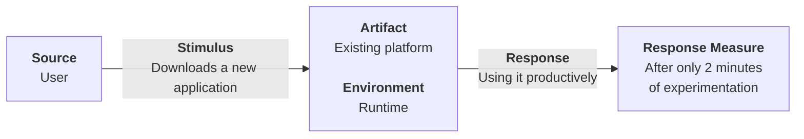
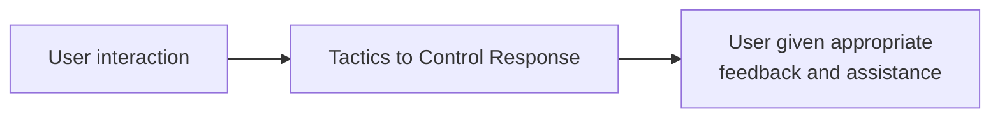
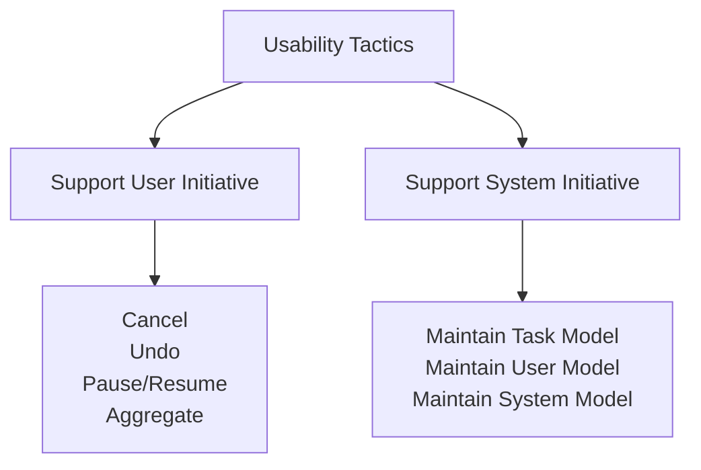
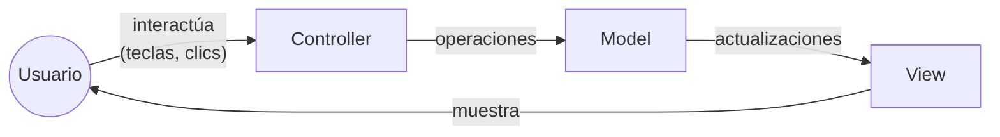
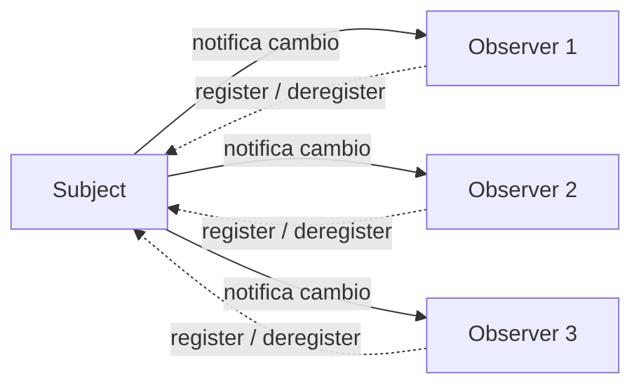
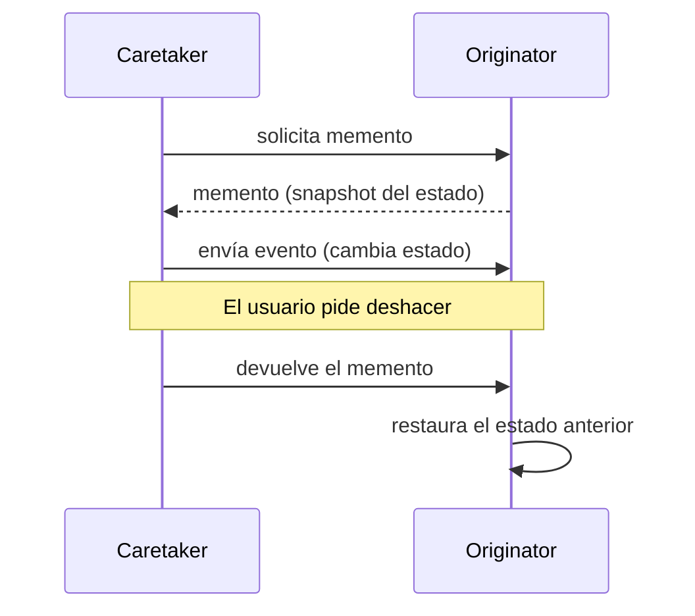

# Usabilidad (Usability)

## Definición

La **usabilidad** se refiere a qué tan fácil es para el usuario realizar una tarea deseada y al tipo de soporte que el sistema le proporciona. A lo largo de los años, enfocarse en la usabilidad ha demostrado ser una de las formas más baratas y fáciles de mejorar la calidad de un sistema (o, más precisamente, la *percepción* de calidad por parte del usuario) y, por lo tanto, la satisfacción del usuario final.

## Áreas de la usabilidad

La usabilidad comprende las siguientes áreas:

**Aprender las funcionalidades del sistema**

Si el usuario no está familiarizado con un sistema en particular o con un aspecto particular del mismo, ¿qué puede hacer el sistema para facilitarle la tarea de aprender? Esto podría incluir proporcionar funciones de ayuda.

**Usar un sistema de manera eficiente**

¿Qué puede hacer el sistema para que el usuario sea más eficiente en su uso? Esto podría incluir permitir que el usuario redirija el sistema después de emitir un comando. Por ejemplo, el usuario puede querer suspender una tarea, realizar varias operaciones y luego reanudar esa tarea.

**Minimizar el impacto de los errores del usuario**

¿Qué puede hacer el sistema para garantizar que un error del usuario tenga un impacto mínimo? Por ejemplo, el usuario puede querer cancelar un comando emitido incorrectamente o deshacer sus efectos.

**Adaptar el sistema a las necesidades del usuario**

¿Cómo puede el usuario (o el propio sistema) adaptarse para facilitar la tarea del usuario? Por ejemplo, el sistema puede autocompletar URLs con base en las entradas anteriores del usuario.

**Aumentar la confianza y la satisfacción**

¿Qué hace el sistema para darle al usuario la confianza de que se está realizando la acción correcta? Por ejemplo, mostrar retroalimentación que indique que el sistema está ejecutando una tarea de larga duración, junto con el porcentaje completado hasta el momento, aumenta la confianza del usuario en el sistema.

# Escenario

## Escenario general

| Portion of Scenario | Description | Possible Values |
|---|---|---|
| **Source** | Where does the stimulus come from? | The end user (who may be in a specialized role, such as a system or network administrator) is the primary source of the stimulus for usability. An external event arriving at a system (to which the user may react) may also be a stimulus source. |
| **Stimulus** | What does the end user want? | End user wants to: use a system efficiently; learn to use the system; minimize the impact of errors; adapt the system; configure the system. |
| **Artifacts** | What portion of the system is being stimulated? | Common examples include: a GUI; a command-line interface; a voice interface; a touch screen. |
| **Environment** | When does the stimulus reach the system? | The user actions with which usability is concerned always occur at runtime or at system configuration time. |
| **Response** | How should the system respond? | The system should: provide the user with the features needed; anticipate the user's needs; provide appropriate feedback to the user. |
| **Response measure** | How is the response measured? | One or more of the following: task time; number of errors; learning time; ratio of learning time to task time; number of tasks accomplished; user satisfaction; gain of user knowledge; ratio of successful operations to total operations; amount of time or data lost when an error occurs. |

## Ejemplo de un escenario concreto

> El usuario descarga una nueva aplicación y la usa productivamente después de 2 minutos de experimentación.

# Tácticas

## Tácticas de usabilidad

Fuente: *Software Architecture in Practice, 4th Edition*

# Tácticas - Soportar la iniciativa del usuario (Support User Initiative)

**Cancelar (Cancel)**

Cuando el usuario emite un comando de cancelación, el sistema debe estar escuchándolo (por lo tanto, existe la responsabilidad de tener un *listener* constante que no quede bloqueado por las acciones de lo que se está cancelando); la actividad que se cancela debe terminarse; cualquier recurso que esté usando la actividad cancelada debe liberarse; y los componentes que colaboran con la actividad cancelada deben ser informados para que también tomen las medidas correspondientes.

**Deshacer (Undo)**

Para soportar la capacidad de deshacer, el sistema debe mantener suficiente información sobre su estado para que se pueda restaurar un estado anterior a pedido del usuario. Este registro puede tomar la forma de "instantáneas" (*snapshots*) del estado, por ejemplo, puntos de control (*checkpoints*), o de un conjunto de operaciones reversibles.

No todas las operaciones se pueden revertir fácilmente. Por ejemplo, cambiar todas las letras "a" por "b" en un documento no se puede revertir cambiando todas las "b" por "a", porque algunas de esas "b" pueden haber existido antes del cambio original. En ese caso, el sistema debe mantener un registro más elaborado del cambio. Y, por supuesto, algunas operaciones no se pueden deshacer en absoluto: no se puede "des-enviar" un paquete ni "des-disparar" un misil.

Deshacer viene en varios sabores. Algunos sistemas permiten un solo deshacer (donde invocar deshacer de nuevo revierte al estado en el que se ordenó el primer deshacer; esencialmente, deshace el deshacer). En otros sistemas, ordenar múltiples deshacer lleva a través de muchos estados anteriores, ya sea hasta cierto límite o hasta el momento en que se abrió la aplicación por última vez.

**Pausar/reanudar (Pause/resume)**

Cuando un usuario ha iniciado una operación de larga duración, por ejemplo, descargar un archivo grande o un conjunto de archivos desde un servidor, a menudo es útil ofrecer la capacidad de pausar y reanudar la operación. Pausar una operación larga puede servir para liberar temporalmente recursos de modo que puedan reasignarse a otras tareas.

**Agregar (Aggregate)**

Cuando un usuario realiza operaciones repetitivas, u operaciones que afectan de la misma manera a una gran cantidad de objetos, es útil ofrecer la capacidad de agrupar los objetos de nivel inferior en un solo grupo, de modo que la operación pueda aplicarse al grupo. Así se libera al usuario de la monotonía, y del riesgo de cometer errores, de realizar la misma operación repetidamente. Un ejemplo es agrupar todos los objetos de una diapositiva y cambiar el texto a una fuente de 14 puntos.

# Tácticas - Soportar la iniciativa del sistema (Support System Initiative)

**Mantener el modelo de tareas (Maintain task model)**

El modelo de tareas se utiliza para determinar el contexto, de modo que el sistema pueda tener una idea de lo que el usuario está intentando hacer y brindarle asistencia. Por ejemplo, muchos motores de búsqueda ofrecen escritura predictiva (*type-ahead*) y muchos clientes de correo ofrecen corrección ortográfica. Ambas funciones se basan en modelos de tareas.

**Mantener el modelo de usuario (Maintain user model)**

Este modelo representa explícitamente el conocimiento que el usuario tiene del sistema, su comportamiento en términos del tiempo de respuesta esperado y otros aspectos específicos de un usuario o de una clase de usuarios. Por ejemplo, las aplicaciones de aprendizaje de idiomas monitorean constantemente las áreas donde un usuario comete errores y luego le ofrecen ejercicios adicionales para corregir esos comportamientos. Un caso especial de esta táctica se encuentra comúnmente en la personalización de la interfaz de usuario, en la que el usuario puede modificar explícitamente el modelo de usuario del sistema.

**Mantener el modelo del sistema (Maintain system model)**

El sistema mantiene un modelo explícito de sí mismo. Este modelo se usa para determinar el comportamiento esperado del sistema, de modo que se le pueda dar al usuario la retroalimentación adecuada. Una manifestación común de un modelo del sistema es una barra de progreso que predice el tiempo necesario para completar la actividad actual.

# Patrones de usabilidad

## Model-View-Controller (MVC)

MVC es probablemente el patrón de usabilidad más conocido. Viene en muchas variantes, como **MVP** (modelo-vista-presentador), **MVVM** (modelo-vista-vista-modelo), **MVA** (modelo-vista-adaptador), etc. Esencialmente, todos estos patrones se centran en separar el **modelo** (la lógica de "negocio" subyacente del sistema) de su realización en una o más **vistas** de la interfaz de usuario.

En el MVC original, el modelo envía actualizaciones a una vista, que el usuario ve y con la que interactúa. Las interacciones del usuario (pulsaciones de teclas, clics, movimientos del mouse, etc.) se transmiten al **controlador**, que las interpreta como operaciones sobre el modelo y las envía al modelo, que cambia su estado en respuesta. La ruta inversa también era parte del MVC original: el modelo podía cambiar y el controlador enviaba actualizaciones a la vista.

El envío de actualizaciones depende de si el MVC está en un solo proceso o distribuido entre procesos (y potencialmente a través de la red). Si está en un solo proceso, las actualizaciones se envían usando el patrón **Observer**. Si está distribuido, a menudo se usa el patrón **publish-subscribe**.

**Beneficios**

- Como MVC promueve una clara separación de responsabilidades (*separation of concerns*), los cambios en un aspecto del sistema, como el diseño de la interfaz (la vista), a menudo no tienen consecuencias para el modelo ni para el controlador.
- Por la misma razón, los desarrolladores pueden trabajar en todos los aspectos del patrón (modelo, vista y controlador) de manera relativamente independiente y en paralelo. Estos aspectos también se pueden probar en paralelo.
- Un modelo puede usarse en sistemas con diferentes vistas, o una vista puede usarse en sistemas con diferentes modelos.

**Tradeoffs**

- MVC puede volverse una carga en interfaces complejas, ya que la información suele quedar repartida en varios componentes. Por ejemplo, si hay varias vistas del mismo modelo, un cambio en el modelo puede requerir cambios en varios componentes que de otro modo no estarían relacionados.
- En interfaces simples, MVC agrega una complejidad inicial que puede no compensarse con ahorros posteriores.
- MVC agrega una pequeña latencia a las interacciones del usuario. Aunque generalmente es aceptable, puede ser problemático en aplicaciones que requieren latencia muy baja.

## Observer (Observador)

El patrón observer es una forma de vincular alguna funcionalidad con una o más vistas. Tiene un **sujeto** (la entidad que se observa) y uno o más **observadores** de ese sujeto. Los observadores deben registrarse con el sujeto; luego, cuando cambia el estado del sujeto, se notifica a los observadores. Este patrón se usa a menudo para implementar MVC (y sus variantes), por ejemplo, para notificar a las distintas vistas sobre cambios en el modelo.

**Beneficios**

- Separa la funcionalidad subyacente de la preocupación de cómo, y cuántas veces, se presenta esa funcionalidad.
- Facilita cambiar los enlaces entre el sujeto y los observadores en tiempo de ejecución.

**Tradeoffs**

- Es excesivo si no se requieren múltiples vistas del sujeto.
- Requiere que todos los observadores se registren y se desregistren con el sujeto. Si un observador no se desregistra, su memoria nunca se libera, lo que en la práctica produce una **fuga de memoria**. Además, esto puede afectar el rendimiento, ya que se seguirán invocando observadores obsoletos.
- Los observadores pueden tener que hacer un trabajo considerable para determinar si reflejan una actualización de estado y cómo, y este trabajo puede repetirse en cada observador. Por ejemplo, si el sujeto es un sensor de temperatura que reporta fluctuaciones de 1/100 de grado, pero la vista solo muestra grados completos, hay un "desajuste de impedancia" (*impedance mismatch*) que puede desperdiciar muchos recursos de procesamiento.

## Memento

El patrón memento es una forma común de implementar la táctica de **deshacer**. Tiene tres componentes principales:

- **Originador (*originator*):** procesa un flujo de eventos que cambian su estado (originados por la interacción del usuario).
- **Cuidador (*caretaker*):** envía eventos al originador que hacen que cambie su estado.
- **Memento:** una instantánea del estado existente.

Cuando el cuidador está a punto de cambiar el estado del originador, puede solicitar un memento y usarlo para restaurar ese estado si es necesario, simplemente devolviéndoselo al originador. De esta forma, el cuidador no sabe nada sobre cómo se maneja el estado; el memento es simplemente una abstracción que el cuidador emplea.

**Beneficios**

- Delega el complicado proceso de implementar deshacer, y de decidir qué estado conservar, a la clase que realmente crea y administra ese estado. En consecuencia, se conserva la abstracción del originador y el resto del sistema no necesita conocer los detalles.

**Tradeoffs**

- Según la naturaleza del estado que se conserva, el memento puede consumir cantidades arbitrariamente grandes de memoria, lo que puede afectar el rendimiento. Prueba, en un documento muy grande, cortar y pegar muchas secciones grandes y luego deshacer todo: es probable que tu procesador de texto se ralentice notablemente.
- En algunos lenguajes de programación es difícil hacer que el memento sea una abstracción opaca.

# Bibliografía

Len Bass, Paul Clements, Rick Kazman. *Software Architecture in Practice*. 4th Edition. SEI / Addison-Wesley, 2022.