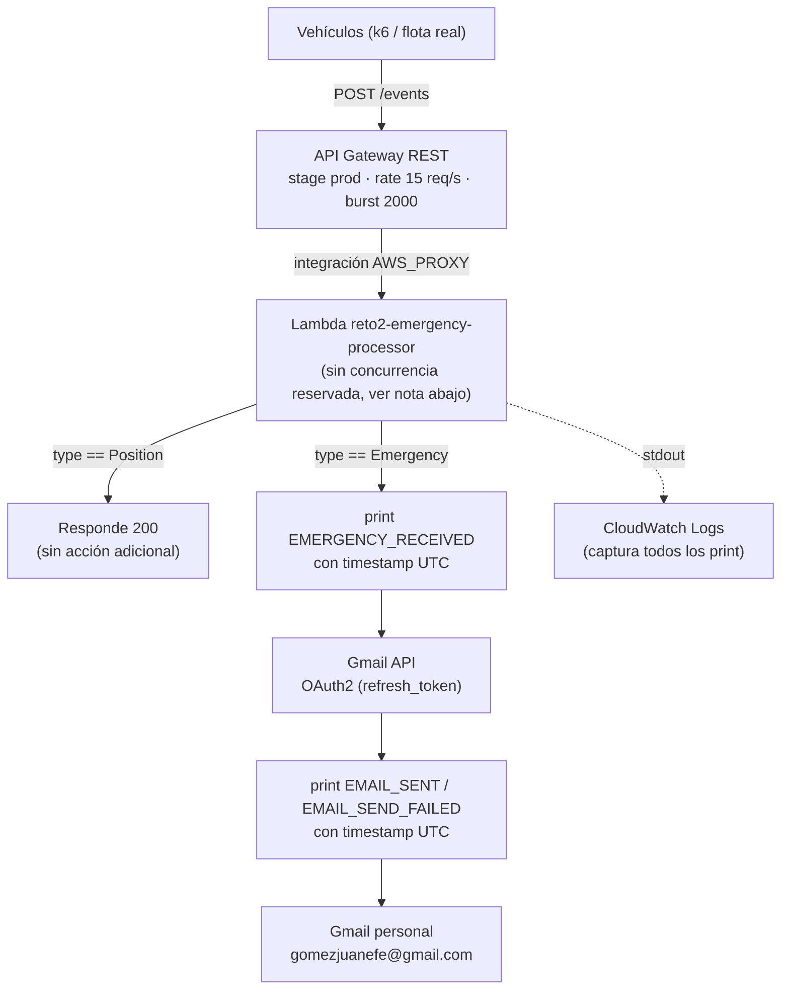

# 0001 – Arquitectura de ingesta y notificación de emergencias

## Contexto

El reto exige recibir 1000 eventos de vehículos (`"Position"` o `"Emergency"`) en 30 segundos,
detectar los eventos `"Emergency"` y enviar un correo a una cuenta Gmail personal en el menor
tiempo posible (objetivo < 15s desde el último envío de k6), bajo restricciones fijas:

- API Gateway: rate 15 req/s, burst 2000, stage `prod`.
- Máximo 10 instancias simultáneas de procesadores.
- Logs explícitos con hora exacta de recepción del `Emergency` y de envío del correo.

## Opciones consideradas

1. **API Gateway + Lambda (Python, concurrencia reservada = 10) + Gmail API (OAuth2)** — procesamiento
   síncrono de punta a punta, sin dependencias externas en el paquete de la función.
2. **API Gateway + ECS/Fargate + Gmail/SES** — requiere mantener tareas corriendo (o auto-scaling con
   latencia de arranque), más complejo de acotar a "10 instancias simultáneas" de forma limpia, y no
   aporta nada frente a Lambda para una carga de 1000 eventos en 30s.
3. **API Gateway + Lambda + Amazon SES** — más "nativo" de AWS y sin necesidad de gestionar OAuth2,
   pero en modo sandbox exige verificar cada dirección destino y no era la tecnología que se quería
   explorar en este reto.
4. **API Gateway + Lambda + SMTP de Gmail con contraseña de aplicación** — evita OAuth2, pero depende
   de una contraseña de aplicación de larga duración y de los límites de envío SMTP de Gmail; menos
   alineado con el ejemplo del enunciado.

## Decisión

Se elige la opción 1:

- **Ingesta:** API Gateway tipo REST, stage `prod`, con `rate = 15` y `burst = 2000` (coincide con la
  configuración pedida en el enunciado y con el screenshot de referencia).
- **Procesamiento:** una función Lambda en Python con **concurrencia reservada = 10**, que mapea
  directamente la restricción "máximo 10 instancias simultáneas" sin necesitar gestión manual.
- **Detección:** dentro del mismo handler, se compara `payload["type"] == "Emergency"`.
- **Notificación:** Gmail API (OAuth2). El `refresh_token` se genera **una sola vez, localmente**, con
  `scripts/generate_gmail_refresh_token.py`, y se guarda como variable de entorno de la Lambda
  (`GMAIL_CLIENT_ID`, `GMAIL_CLIENT_SECRET`, `GMAIL_REFRESH_TOKEN`, `GMAIL_TO`). La Lambda intercambia
  ese refresh token por un access token en cada invocación que lo necesita.
- **Código sin dependencias externas:** `lambda/handler.py` usa solo la librería estándar de Python
  (`urllib`, `email.mime`, `base64`, `json`) para poder pegarse directo en el editor inline de la
  consola de Lambda, sin tener que armar un zip ni una layer.
- **Despliegue:** manual vía AWS CLI (sin IaC ni pipeline), dado el alcance puntual de este reto. Se
  prefirió CLI sobre la consola web una vez instalada, por ser más rápido de reproducir y de
  documentar aquí.
- **Logs:** `print()` con timestamp explícito en UTC (`datetime.now(timezone.utc).isoformat(...)`) en
  dos puntos: `[EMERGENCY_RECEIVED]` al recibir el evento y `[EMAIL_SENT]` (o
  `[EMAIL_SEND_FAILED]`) al terminar el intento de envío. CloudWatch Logs captura ambos automáticamente.
- **Resiliencia mínima:** si el envío de correo falla, se loguea el error pero la función de todos
  modos responde `200` al API Gateway — no se quiere que una falla de Gmail tumbe el contrato HTTP
  que valida k6 (`is status 200`).

## Diagrama de arquitectura

El camino crítico para la nota de la rúbrica es `V → AG → L → LOG1 → GM → LOG2`: todo síncrono, en una
sola invocación, sin colas intermedias — es la traducción directa del atributo de calidad priorizado
(latencia).

## Tácticas de arquitectura

Tácticas aplicadas, agrupadas por el atributo de calidad que atienden (catálogo de Bass/Clements/Kazman):

**Rendimiento (atributo priorizado)**

- *Reducir el overhead computacional:* `lambda/handler.py` usa solo la librería estándar de Python
  (`urllib`, `email.mime`, `base64`, `json`) — sin SDKs ni dependencias que empaquetar, lo que
  minimiza el tamaño del paquete y el tiempo de cold start.
- *Minimizar el número de intermediarios:* detección y notificación ocurren en la misma invocación
  síncrona de Lambda, sin colas (SQS/SNS) ni pasos asíncronos entre recibir el `Emergency` y llamar a
  Gmail API — cada paso intermedio adicional sumaría latencia al camino crítico.
- *Controlar la demanda de recursos:* el throttling de API Gateway (`rate=15`, `burst=2000`) acota la
  tasa de entrada para que la Lambda nunca reciba más carga de la que puede atender de forma
  consistente, evitando colas de espera que degradarían la latencia por petición.
- *Gestionar recursos (bound resource usage):* la intención arquitectónica es acotar el número de
  ejecuciones paralelas de la Lambda (reservar concurrencia) para que el procesamiento no escale sin
  control; en esta cuenta terminó dependiendo del límite de cuenta en vez de una reserva explícita —
  ver la nota de implementación más abajo.

**Disponibilidad**

- *Ignorar comportamiento defectuoso (ignore faulty behavior):* el `try/except` alrededor de
  `_send_alert_email` evita que una falla de Gmail (timeout, 401, etc.) tumbe la respuesta HTTP — la
  función siempre devuelve `200`, preservando el contrato que valida k6 (`is status 200`) aunque la
  notificación falle.
- *Detección de fallos vía logging explícito:* cada fallo de envío se loguea como
  `EMAIL_SEND_FAILED` con el error y el timestamp exacto, permitiendo diagnosticar sin necesitar que
  la petición HTTP falle ni reintentar automáticamente (fuera de alcance de este reto).

**Modificabilidad**

- *Encapsular:* toda la lógica de Gmail OAuth2 vive en dos funciones separadas del handler principal
  (`_get_access_token`, `_send_alert_email`); cambiar de proveedor de notificación (ej. a SES) solo
  tocaría esas dos funciones, no la lógica de detección del evento `Emergency`.

## Consecuencias (trade-offs)

- **Gana:** latencia mínima (todo síncrono en una sola invocación, sin colas intermedias), cero
  dependencias que empaquetar, y una restricción de arquitectura ("10 instancias") que se traduce
  literalmente a una configuración de AWS sin trabajo adicional.
- **Pierde:** acoplamiento entre detección y notificación — si Gmail API responde lento, esa
  invocación puntual tarda más (aunque igual devuelve 200); el `refresh_token` es un secreto de larga
  vida que vive en variables de entorno de Lambda, sin rotación ni Secrets Manager en este alcance.
- **Atributo de calidad priorizado:** **tiempo de respuesta / latencia** (el objetivo explícito de
  < 15s de punta a punta), por encima de resiliencia o desacoplamiento del pipeline de notificación.

## Nota de implementación — concurrencia reservada

La cuenta de AWS usada (nueva, sin historial de uso) tiene un límite de cuenta de solo 10 ejecuciones
concurrentes de Lambda en `sa-east-1` (`aws lambda get-account-settings`). AWS exige mantener al menos
10 de concurrencia **sin reservar** a nivel de cuenta, por lo que no es posible reservar 10 para esta
función específica (dejaría 0 sin reservar). Se decidió **no reservar concurrencia explícitamente**:
el límite de cuenta ya topa el total en 10, cumpliendo de facto la restricción "máximo 10 instancias
simultáneas" sin necesitar un aumento de cuota ante AWS. Si en el futuro se solicita un aumento del
límite de cuenta, habría que volver a aplicar `aws lambda put-function-concurrency
--reserved-concurrent-executions 10` para que la restricción siga siendo explícita y no dependa del
límite de cuenta.
