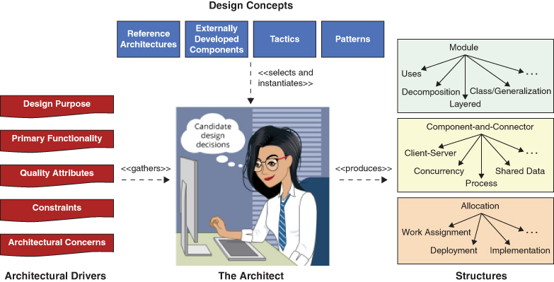
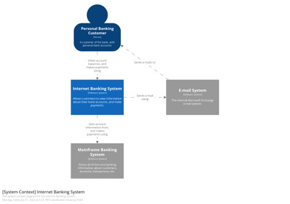
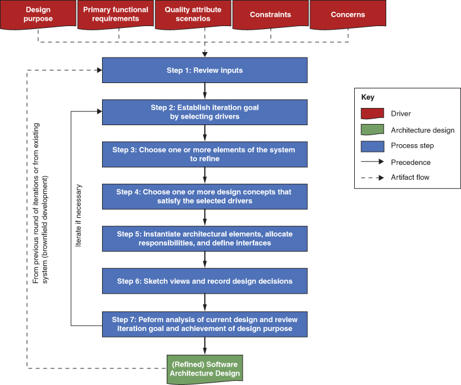
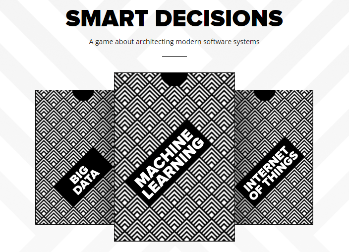
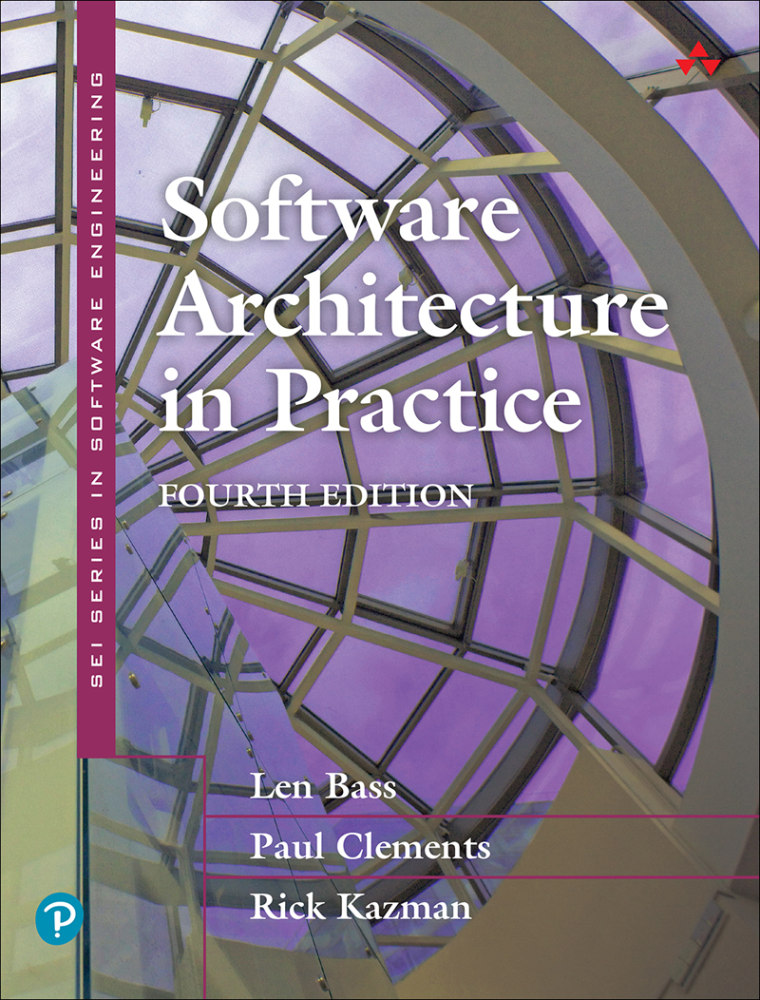
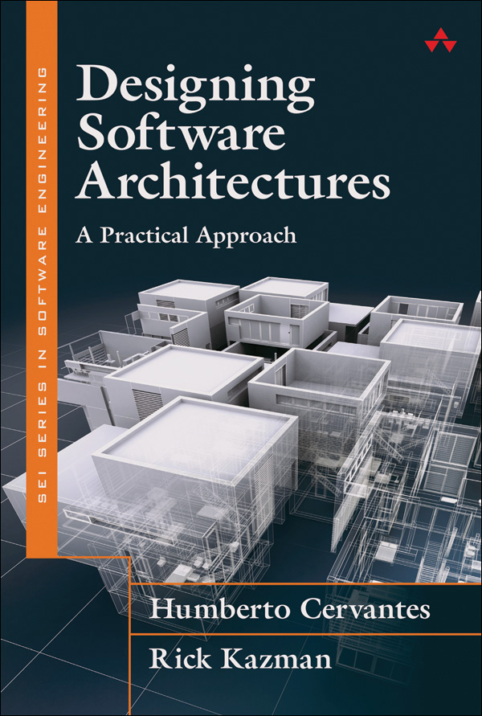

# Diseño Basado en Atributos (ADD)

> Anexo del [Módulo 3](../Modulo-3.md) — Profundización.

## Introducción

El diseño, incluido el diseño arquitectónico, es una actividad compleja: implica tomar una gran cantidad de decisiones que consideran muchos aspectos de un sistema. En el pasado, esta tarea solo se confiaba a ingenieros de software sénior ("gurús") con décadas de experiencia. Un **método sistemático** da orientación para realizar esta actividad, de modo que pueda ser aprendida y ejecutada con habilidad por cualquiera.

El **Diseño Basado en Atributos** (*Attribute-Driven Design*, **ADD**) permite diseñar una arquitectura de manera **sistemática, repetible y rentable**. La repetibilidad y la capacidad de aprendizaje son los sellos distintivos de una disciplina de ingeniería. Para que un método sea repetible y enseñable, se necesita un conjunto de pasos que cualquier ingeniero debidamente capacitado pueda seguir.

## Drivers arquitectónicos

El diseño arquitectónico de sistemas de software no es diferente del diseño en general: implica tomar decisiones y trabajar con los materiales y habilidades disponibles para satisfacer requisitos y restricciones. En el diseño arquitectónico, **las decisiones sobre los drivers arquitectónicos se convierten en estructuras**.

Los **drivers arquitectónicos** incluyen los **requisitos arquitectónicamente significativos** (ASR), pero también:

| Driver | Descripción |
|---|---|
| **Propósito del diseño** (*Design purpose*) | Para qué se está diseñando en esta ronda. |
| **Funcionalidad primaria** (*Primary functionality*) | Los requisitos funcionales más importantes. |
| **Atributos de calidad** (*Quality attributes*) | Expresados como escenarios de atributos de calidad. |
| **Restricciones** (*Constraints*) | Decisiones ya tomadas que no se pueden cambiar. |
| **Preocupaciones arquitectónicas** (*Architectural concerns*) | Temas que el arquitecto debe abordar aunque no estén en los requisitos. |

Las estructuras resultantes se usan para guiar el proyecto de muchas formas:

- Guían el análisis y la construcción.
- Sirven como base para educar a un nuevo miembro del proyecto.
- Guían las estimaciones de costos y cronogramas, la formación de equipos, el análisis y la mitigación de riesgos y, por supuesto, la implementación.

## Descripción general de la actividad de diseño

*Descripción general de la actividad de diseño de arquitectura.*

El arquitecto **recopila** los drivers arquitectónicos, **selecciona e instancia** conceptos de diseño (arquitecturas de referencia, componentes desarrollados externamente, tácticas y patrones) y **produce** estructuras:

| Tipo de estructura | Ejemplos |
|---|---|
| **Módulo** | Usos, descomposición, capas, clases/generalización. |
| **Componente y conector** | Cliente-servidor, concurrencia, procesos, datos compartidos. |
| **Asignación** | Asignación de trabajo, despliegue, implementación. |

## Contexto del sistema

Antes de comenzar el diseño de la arquitectura, es importante **determinar el alcance del sistema**: qué hay dentro y qué hay fuera del sistema que se está creando, y con qué entidades externas interactuará. Este contexto se puede representar con un **diagrama de contexto del sistema**.

*Ejemplo de diagrama de contexto (nivel 1 de C4): Internet Banking System. Ver [Técnicas de diagramación](./Tecnicas-Diagramacion.md).*

# Los pasos del proceso ADD

*Pasos del proceso ADD.*

| Paso | Actividad |
|---|---|
| **1** | Revisar las entradas. |
| **2** | Establecer el objetivo de la iteración mediante la selección de drivers. |
| **3** | Elegir uno o más elementos del sistema para refinar. |
| **4** | Elegir uno o más conceptos de diseño que satisfagan los drivers seleccionados. |
| **5** | Instanciar elementos arquitectónicos, asignar responsabilidades y definir interfaces. |
| **6** | Bocetar las vistas y registrar las decisiones de diseño. |
| **7** | Analizar el diseño actual y revisar el objetivo de la iteración y el logro del propósito del diseño. |
| ↺ | Iterar si es necesario (pasos 2 a 7). |

> El paso 1 se hace una vez por ronda de diseño. Los pasos 2 a 7 forman la **iteración**, que se repite hasta satisfacer los drivers. El resultado es un **diseño de arquitectura de software (refinado)**, que puede alimentar una nueva ronda de diseño o, en sistemas existentes (*brownfield*), servir de punto de partida.

## Paso 1: Revisar las entradas

Antes de comenzar una ronda de diseño, hay que asegurarse de que los **drivers arquitectónicos** (las entradas del proceso de diseño) estén disponibles y sean correctos. Estos incluyen:

- El propósito de la ronda de diseño.
- Los requisitos funcionales primarios.
- Los escenarios de atributos de calidad primarios.
- Cualquier restricción.
- Cualquier preocupación.

## Paso 2: Establecer el objetivo de la iteración mediante la selección de drivers

Cada iteración de diseño se enfoca en lograr un **objetivo particular**, que generalmente implica diseñar para satisfacer un **subconjunto de los drivers**. Por ejemplo, un objetivo de iteración podría ser crear estructuras a partir de elementos que permitan lograr un escenario de rendimiento particular o un caso de uso. Por eso, antes de iniciar una iteración, se debe establecer su objetivo.

## Paso 3: Elegir uno o más elementos del sistema para refinar

Satisfacer los drivers requiere tomar decisiones de diseño arquitectónico, que se manifiestan en una o más estructuras. Estas estructuras se componen de elementos interrelacionados (módulos y/o componentes), que generalmente se obtienen al **refinar** elementos identificados en una iteración anterior. Refinar puede significar:

- **Descomponer** en elementos de grano más fino (enfoque *top-down*).
- **Combinar** elementos en elementos de grano más grueso (enfoque *bottom-up*).
- **Mejorar** elementos previamente identificados.

**¿Qué elemento elegir?**

- **Sistema nuevo (*greenfield*):** se puede comenzar por establecer el contexto del sistema y seleccionar el único elemento disponible, el sistema mismo, para refinarlo mediante descomposición.
- **Sistema existente o iteraciones posteriores:** normalmente se refinan elementos identificados en iteraciones anteriores.

Los elementos seleccionados son los que intervienen en la satisfacción de drivers específicos. Por eso, cuando el diseño aborda un sistema existente, hay que entender bien los elementos de la arquitectura ya construida. Obtener esta información puede requerir "trabajo de detective", ingeniería inversa o conversaciones con los desarrolladores.

> En algunos casos es posible **invertir el orden de los pasos 2 y 3**. Por ejemplo, al diseñar un sistema totalmente nuevo o ciertos tipos de arquitecturas de referencia, al menos en las primeras etapas, el foco está en los elementos del sistema: se comienza la iteración seleccionando un elemento y luego se consideran los drivers que se quieren abordar.

## Paso 4: Elegir uno o más conceptos de diseño que satisfagan los drivers seleccionados

Elegir los conceptos de diseño es probablemente **la decisión más difícil** del proceso: requiere identificar los distintos conceptos que podrían usarse para lograr el objetivo de la iteración y luego elegir entre esas alternativas. Hay muchos tipos de conceptos de diseño:

- Tácticas.
- Patrones.
- Arquitecturas de referencia.
- Componentes desarrollados externamente.

Para cada tipo pueden existir muchas opciones, lo que puede generar un número considerable de alternativas que deben analizarse antes de decidir.

## Paso 5: Instanciar elementos arquitectónicos, asignar responsabilidades y definir interfaces

Una vez seleccionados los conceptos de diseño, hay que tomar tres tipos de decisiones:

**Instanciar elementos.** Decidir cómo crear elementos concretos a partir de los conceptos seleccionados. Por ejemplo, si se eligió el patrón de capas, hay que decidir cuántas capas se usarán y qué relaciones se permiten entre ellas, porque el patrón en sí no lo prescribe.

**Asignar responsabilidades.** Cada elemento instanciado necesita responsabilidades. Por ejemplo, en una aplicación suelen estar al menos estas tres capas:

| Capa | Responsabilidad |
|---|---|
| **Presentación** | Gestionar todas las interacciones con el usuario. |
| **Negocio** | Gestionar la lógica de la aplicación y hacer cumplir las reglas de negocio. |
| **Datos** | Gestionar la persistencia y la coherencia de los datos. |

**Definir interfaces.** Los elementos instanciados también deben estar conectados para poder colaborar. Esto requiere relaciones entre ellos e intercambio de información a través de algún tipo de **interfaz**: una especificación contractual que indica cómo debe fluir la información entre los elementos.

## Paso 6: Bocetar las vistas y registrar las decisiones de diseño

Al terminar las actividades de diseño de la iteración, hay que asegurarse de **conservar las vistas** (las representaciones de las estructuras creadas). Por ejemplo, si el paso 5 se hizo en una sala de reuniones, probablemente quedó una serie de diagramas en una pizarra. Esta información es esencial para el resto del proceso y debe capturarse para analizarla y comunicarla a otros *stakeholders*. Capturar las vistas puede ser tan simple como tomarle una foto a la pizarra.

**¿Por qué "bocetar"?** Es casi seguro que las vistas creadas no están completas, así que probablemente deban revisarse y refinarse en una iteración posterior para acomodar elementos de otras decisiones de diseño. Por eso ADD habla de **"bocetar"** las vistas: un boceto es documentación preliminar. La documentación más formal y completa, si se decide producirla, ocurre solo después de terminar las iteraciones de diseño, como parte de la actividad de documentación arquitectónica.

**Registrar las decisiones.** Además de los bocetos, hay que registrar las decisiones importantes de la iteración y las razones que las motivaron (la **justificación**), para facilitar su análisis y comprensión posteriores. Por ejemplo, las decisiones sobre *tradeoffs* importantes deben registrarse en este momento. Durante una iteración, las decisiones se toman principalmente en los **pasos 4 y 5**.

## Paso 7: Analizar el diseño actual y revisar el objetivo de la iteración y el logro del propósito del diseño

En este punto debería existir un **diseño parcial** que aborde el objetivo de la iteración. Hay que verificar que realmente sea así, para evitar *stakeholders* insatisfechos y reprocesos.

- **Analizar el diseño.** Se puede hacer revisando uno mismo los bocetos y las decisiones registradas, pero es aún mejor que **otra persona** ayude a revisarlo. Es la misma razón por la que las organizaciones suelen tener un grupo de pruebas/control de calidad separado: otra persona no comparte las mismas suposiciones y tiene otra experiencia y otra perspectiva.
- **Revisar el estado de la arquitectura.** Después de analizar el diseño de la iteración, hay que revisar el estado de la arquitectura frente al propósito de diseño establecido: ¿se han hecho suficientes iteraciones para satisfacer los drivers de esta ronda? ¿Se logró el propósito del diseño o se necesitan rondas adicionales en futuros incrementos del proyecto?

## Iterar si es necesario

Idealmente, se deberían hacer iteraciones adicionales, repitiendo los pasos 2 a 7 para cada driver considerado. Sin embargo, la mayoría de las veces no es posible por limitaciones de tiempo o de recursos que obligan a detener el diseño y pasar a la implementación.

**¿Cómo decidir si hacen falta más iteraciones?** ***Que el riesgo sea la guía.***

- Como mínimo, se deben haber abordado los drivers de **mayor prioridad**.
- Idealmente, se debe tener la certeza de que los drivers críticos están satisfechos o, al menos, de que el diseño es **"suficientemente bueno"** para satisfacerlos.

# Para practicar: Smart Decisions

[**Smart Decisions**](https://smartdecisionsgame.com/) es un juego sobre cómo diseñar la arquitectura de sistemas de software modernos (Big Data, Machine Learning, Internet of Things), basado en el método ADD.

# Bibliografía

| | |
|---|---|
|  | Len Bass, Paul Clements, Rick Kazman. *Software Architecture in Practice*. 4th Edition. SEI / Addison-Wesley, 2022. |
|  | Humberto Cervantes, Rick Kazman. *Designing Software Architectures: A Practical Approach*. SEI / Addison-Wesley, 2016. |
