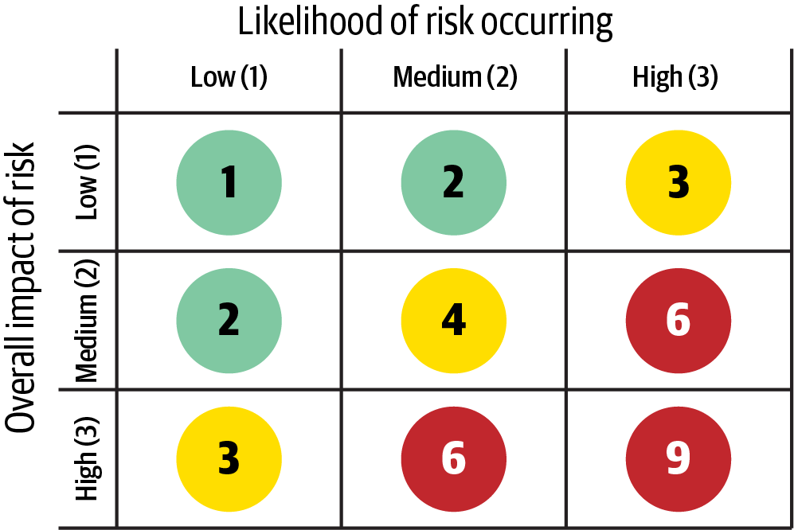
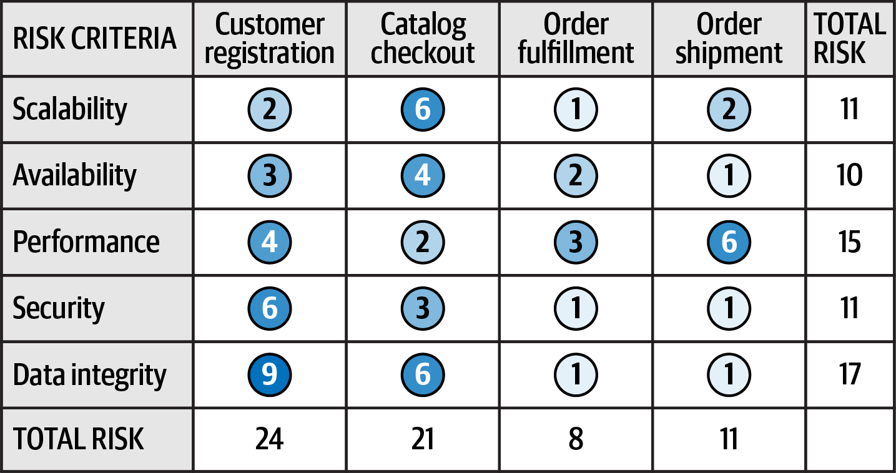
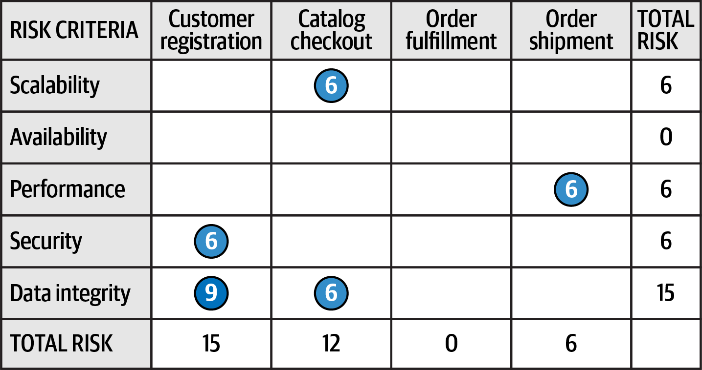
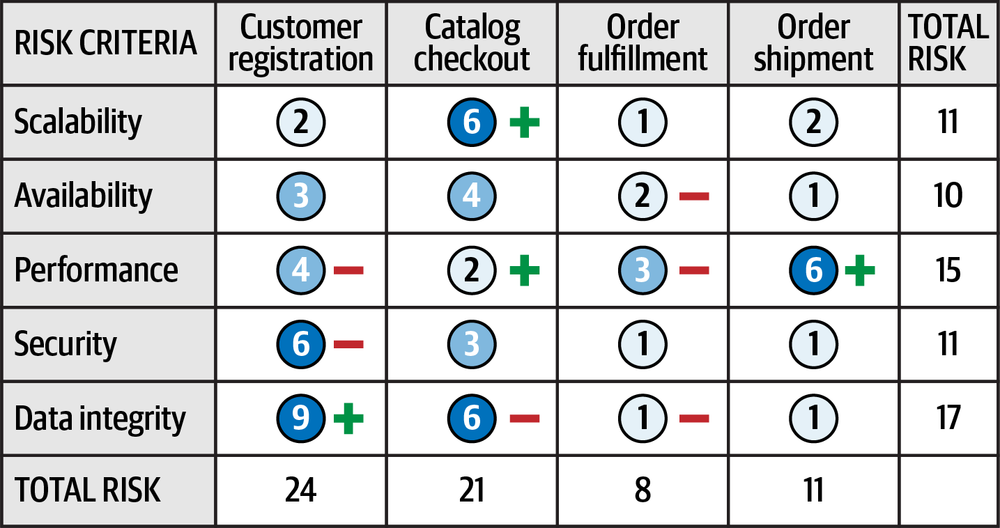
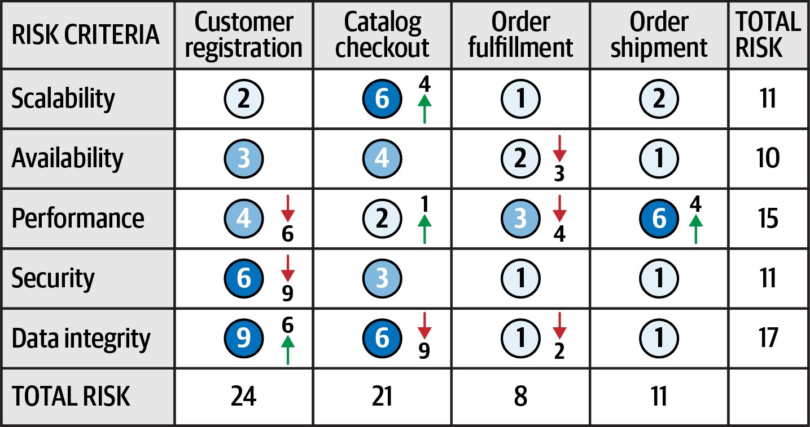
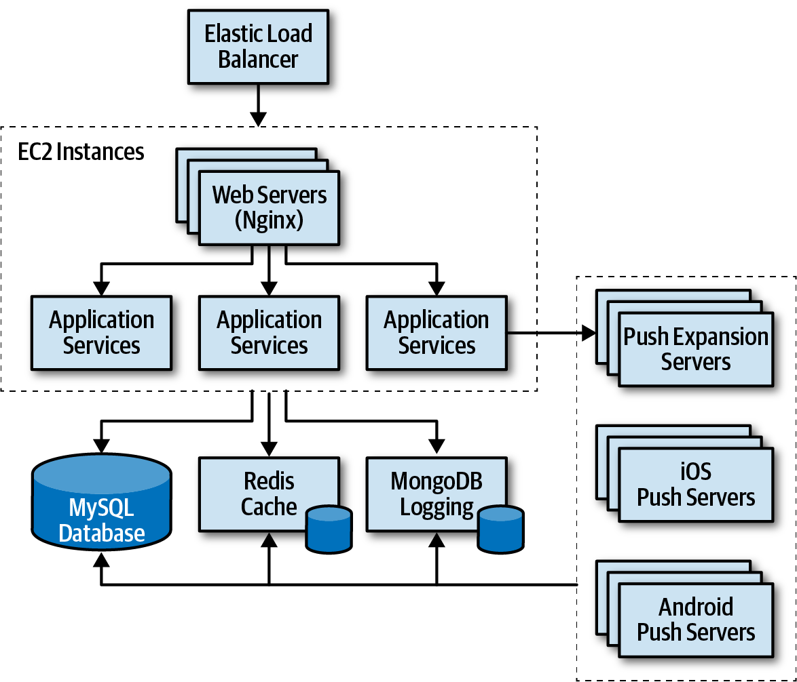
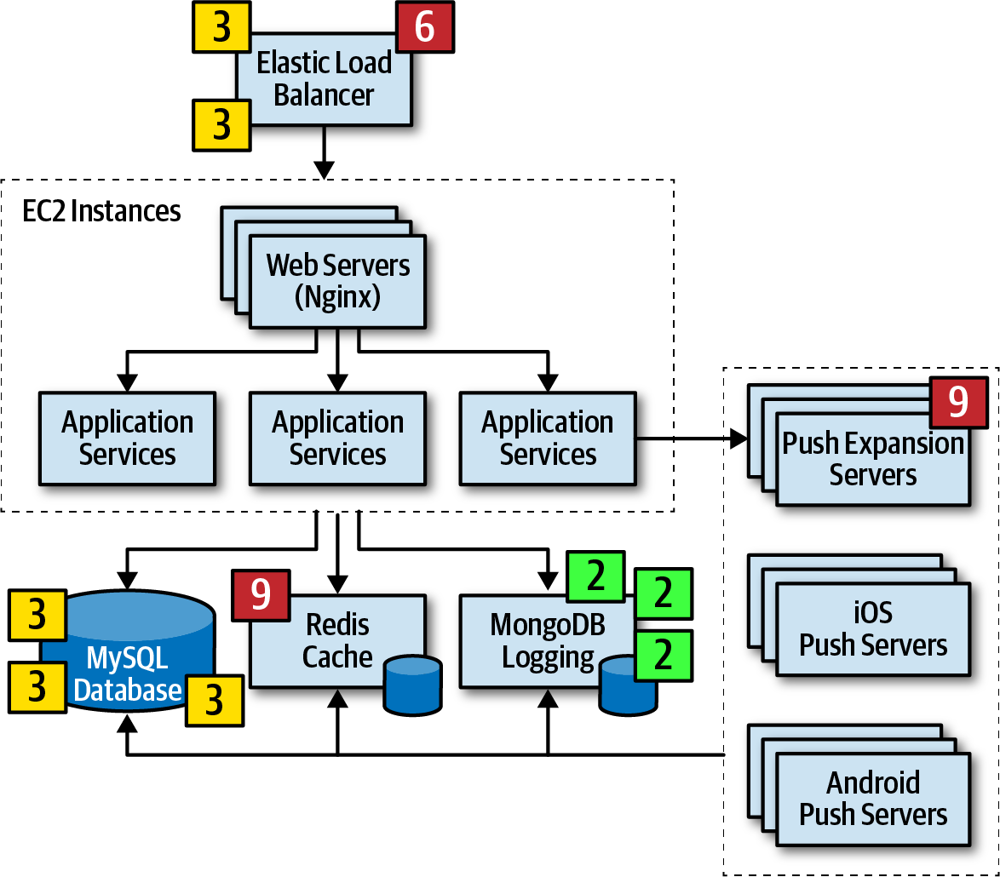
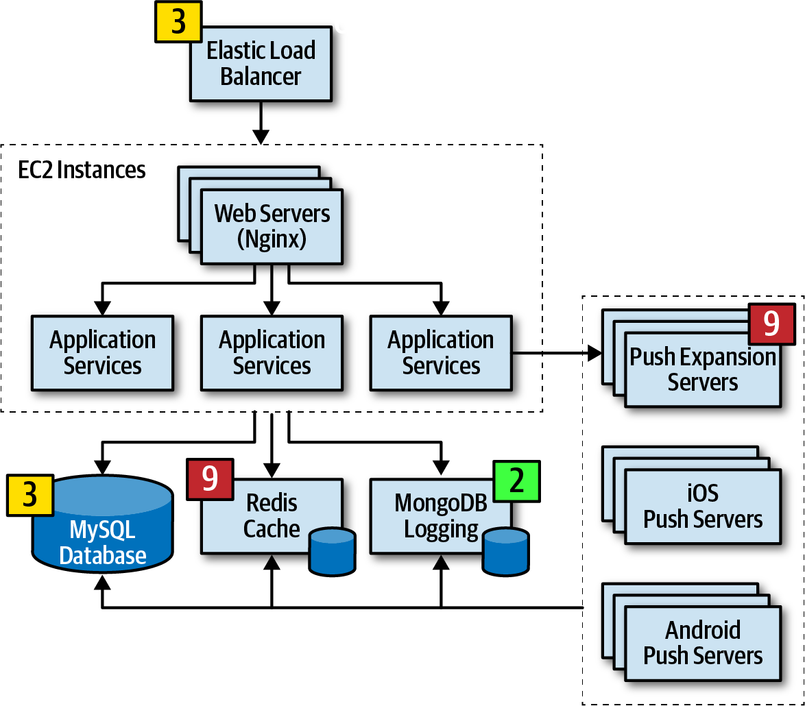
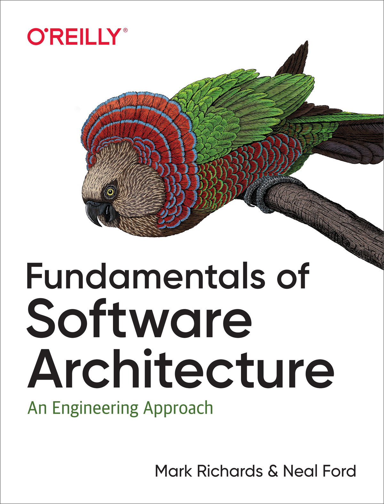

# Análisis de Riesgos

> Anexo del [Módulo 3](./Modulo-3.md) — Cierre.

## Introducción

Toda arquitectura tiene un riesgo asociado, ya sea relacionado con la disponibilidad, la escalabilidad o la integridad de los datos. **Analizar el riesgo de la arquitectura es una de las actividades clave del arquitecto.** Al analizarlo de forma continua, el arquitecto puede abordar las deficiencias de la arquitectura y tomar medidas correctivas para mitigarlo.

Este anexo cubre tres técnicas que se construyen una sobre otra:

| Técnica | Para qué sirve |
|---|---|
| **Matriz de riesgos** | Calificar un riesgo de forma objetiva según su impacto y su probabilidad. |
| **Evaluación de riesgos** | Resumir el riesgo de toda la arquitectura por criterio y por área del sistema. |
| **Lluvia de riesgos** (*risk storming*) | Identificar, consensuar y mitigar riesgos de forma colaborativa con el equipo. |

# Matriz de riesgos

El primer problema al evaluar el riesgo de una arquitectura es decidir si un riesgo es **bajo, medio o alto**. Por lo general, esta clasificación tiene demasiada subjetividad, lo que genera confusión sobre qué partes de la arquitectura son realmente de riesgo alto y cuáles de riesgo medio. La **matriz de riesgos** ayuda a reducir esa subjetividad y a calificar el riesgo de un área particular de la arquitectura.



*Matriz de riesgos: impacto general del riesgo (filas) × probabilidad de que ocurra (columnas).*

La matriz usa **dos dimensiones**:

- **Impacto general** del riesgo.
- **Probabilidad** de que el riesgo ocurra.

Cada dimensión se califica como baja (**1**), media (**2**) o alta (**3**). Los dos números se **multiplican**, lo que da un valor objetivo para ese riesgo:

| Resultado | Nivel de riesgo | Color |
|---|---|---|
| 1 – 2 | Bajo | 🟢 Verde |
| 3 – 4 | Medio | 🟡 Amarillo |
| 6 – 9 | Alto | 🔴 Rojo |

## Ejemplo

Suponga que hay una preocupación sobre la **disponibilidad** de la base de datos central primaria de la aplicación.

1. **Impacto:** ¿cuál es el impacto general si la base de datos deja de funcionar? El arquitecto lo considera **alto (3)**, así que el riesgo podría ser 3 (medio), 6 (alto) o 9 (alto), según la probabilidad.
2. **Probabilidad:** la base de datos está en servidores de alta disponibilidad, en una configuración en clúster, así que la probabilidad de que deje de estar disponible es **baja (1)**.
3. **Resultado:** alto impacto × baja probabilidad = **3 → riesgo medio**.

# Evaluación de riesgos

La matriz de riesgos se usa para construir una **evaluación de riesgos** (*risk assessment*): un **informe resumido** del riesgo general de una arquitectura con respecto a algún criterio de evaluación contextual y significativo. Las evaluaciones de riesgos pueden variar mucho, pero en general contienen el riesgo (calificado con la matriz) de ciertos **criterios** evaluados sobre los **servicios o áreas de dominio** de una aplicación.



*Ejemplo de evaluación de riesgos: criterios de riesgo (filas) × áreas de dominio (columnas).*

> **Convenciones:** el gris claro (1-2) es riesgo bajo, el gris medio (3-4) es riesgo medio y el gris oscuro (6-9) es riesgo alto. Normalmente se usan los colores verde, amarillo y rojo, pero el sombreado sirve para la impresión en blanco y negro y para personas con daltonismo.

## Riesgo acumulado

El riesgo cuantificado se puede **acumular por criterio de riesgo** y también **por área de dominio o servicio**. En el ejemplo:

| Lectura | Resultado |
|---|---|
| Criterio con **más** riesgo | **Data integrity** (integridad de datos), con un total de **17**. |
| Criterio con **menos** riesgo | **Availability** (disponibilidad), con un total de **10**. |
| Área de dominio con **más** riesgo | **Customer registration** (registro de clientes), con **24**. |
| Área de dominio con **menos** riesgo | **Order fulfillment** (cumplimiento de pedidos), con **8**. |

Estos números relativos se pueden **rastrear en el tiempo** para demostrar mejoras o degradación del riesgo dentro de un criterio o un área de dominio.

## Filtrar la evaluación

Aunque el ejemplo anterior contiene todos los resultados del análisis, **rara vez se presenta así**. El filtrado es esencial para transmitir un mensaje particular dentro de un contexto dado. Por ejemplo, si el arquitecto está en una reunión para presentar las áreas del sistema de alto riesgo, puede mostrar **solo las áreas de alto riesgo**. Esto mejora la relación señal-ruido y da una imagen clara del estado del sistema (bueno o malo).



*Evaluación de riesgos filtrada: solo se muestran los riesgos altos.*

## Mostrar la dirección del riesgo

Una evaluación muestra el estado del riesgo en un momento dado. Para saber si el riesgo **mejora o empeora** con el tiempo, se puede indicar su **dirección**:

**Con signos más y menos.** Un **+** (verde) indica que el riesgo mejora y un **−** (rojo) que empeora.



*Mostrando la dirección del riesgo con signos más y menos.*

**Con flechas y números.** Una flecha indica la dirección (↑ verde: mejora; ↓ rojo: empeora) y el número junto a ella indica el valor hacia el que se mueve el riesgo.



*Mostrando la dirección del riesgo con flechas y números.*

# Lluvia de riesgos (*Risk storming*)

**Ningún arquitecto puede determinar por sí solo el riesgo general de un sistema.** Un solo arquitecto puede pasar por alto un área de riesgo, y muy pocos tienen pleno conocimiento de cada parte del sistema. Aquí es donde ayuda la lluvia de riesgos.

La **lluvia de riesgos** es un ejercicio **colaborativo** para determinar el riesgo arquitectónico dentro de una **dimensión** específica. Las dimensiones (áreas de riesgo) más comunes son:

- Tecnología no probada.
- Rendimiento.
- Escalabilidad.
- Disponibilidad (incluidas las dependencias transitivas).
- Pérdida de datos.
- Puntos únicos de falla.
- Seguridad.

> **¿Quiénes participan?** La mayoría de las lluvias de riesgos involucran a varios arquitectos, pero es recomendable incluir también a **desarrolladores sénior y líderes técnicos**. Aportan una perspectiva de implementación sobre el riesgo y, además, participar les ayuda a entender mejor la arquitectura.

## Parte individual y parte colaborativa

| Parte | Qué se hace | Por qué |
|---|---|---|
| **Individual** | Cada participante, sin colaborar con los demás, asigna riesgo a las áreas de la arquitectura usando la matriz de riesgos. | Evita que los participantes se influyan entre sí o desvíen la atención de ciertas áreas. |
| **Colaborativa** | Todos trabajan juntos para lograr consenso sobre las áreas de riesgo, discutirlo y proponer soluciones para mitigarlo. | Combina el conocimiento de todo el equipo. |

En ambas partes se usa un **diagrama de arquitectura**:

- Para evaluaciones **holísticas**, un diagrama de arquitectura **integral**.
- Para áreas **específicas** de la aplicación, un diagrama de arquitectura **contextual**.

Es responsabilidad del arquitecto que dirige la lluvia de riesgos asegurarse de que los diagramas estén actualizados y disponibles para todos.

## Arquitectura de ejemplo



*Arquitectura de ejemplo para ilustrar la lluvia de riesgos.*

Un **Elastic Load Balancer** está delante de cada instancia **EC2**, que contiene los servidores web (**Nginx**) y los servicios de aplicación. Los servicios de aplicación llaman a:

- Una base de datos **MySQL**.
- Un caché **Redis**.
- Una base de datos **MongoDB** para los logs.
- Los **Push Expansion Servers** (servidores de expansión para notificaciones *push*).

A su vez, los Push Expansion Servers interactúan con la base de datos MySQL, el caché Redis y el registro en MongoDB, y envían a los servidores push de **iOS** y **Android**.

## Las tres actividades

```text
Identificación (individual)  →  Consenso (colaborativa)  →  Mitigación (colaborativa)
```

La **identificación** es siempre una actividad **individual**, mientras que el **consenso** y la **mitigación** son siempre **colaborativos** e involucran a todos los participantes trabajando juntos en la misma sala (al menos virtualmente).

### 1. Identificación

Cada participante identifica individualmente las áreas de riesgo de la arquitectura:

1. El arquitecto que dirige la lluvia de riesgos envía una **invitación** a todos los participantes **uno o dos días antes** de la parte colaborativa. La invitación incluye el diagrama de arquitectura (o dónde encontrarlo), la **dimensión** de riesgo que se analizará, la fecha de la parte colaborativa y el lugar.
2. Usando la **matriz de riesgos**, cada participante analiza la arquitectura y clasifica el riesgo como bajo (1-2), medio (3-4) o alto (6-9).
3. Los participantes preparan **notas Post-it** de los colores correspondientes (verde, amarillo y rojo) y escriben en ellas el número de riesgo.

### 2. Consenso

Esta actividad es altamente colaborativa y busca el **consenso** de todos los participantes sobre el riesgo de la arquitectura. Es más eficaz con una **versión impresa grande** del diagrama colgada en la pared o, en su defecto, una versión electrónica en una pantalla grande.

Al llegar a la sesión, los participantes **colocan sus Post-it** en el diagrama, en el área donde encontraron el riesgo. Si se usa una versión electrónica, el arquitecto consulta a cada participante y coloca el riesgo en el diagrama.



*Riesgos identificados por los participantes, colocados sobre el diagrama de arquitectura.*

Una vez que todos los Post-it están en su lugar, empieza la discusión en equipo para **analizar las áreas de riesgo y llegar a un acuerdo sobre su calificación**. Como se ve en el diagrama, se identificaron varias áreas de riesgo, y en algunas los participantes no coincidieron (por ejemplo, el Elastic Load Balancer recibió un 3 y un 6).



*Diagrama después de la discusión, con las calificaciones de riesgo acordadas.*

### 3. Mitigación

Una vez que todos están de acuerdo en la calificación de las áreas de riesgo, se realiza la **actividad final y más importante**: la **mitigación del riesgo**.

Mitigar el riesgo suele implicar **cambios o mejoras** en áreas de la arquitectura que, de otro modo, se habrían considerado perfectas tal como estaban. Esta actividad, que también suele ser colaborativa, busca formas de **reducir o eliminar** el riesgo identificado:

- En algunos casos, la arquitectura original debe **cambiarse por completo**.
- En otros, basta con una **refactorización sencilla**, como agregar una cola para manejar la contrapresión (*back pressure*) y reducir un cuello de botella de rendimiento.

**La mitigación tiene un costo.** Sean cuales sean los cambios, esta actividad suele tener un costo adicional. Por eso, los *stakeholders* clave suelen decidir si **el costo justifica el riesgo**.

**Ejemplo de negociación (notas del orador):**

| | Propuesta | Costo | Decisión |
|---|---|---|---|
| **Riesgo** | La base de datos central tiene riesgo **medio (4)** respecto a la disponibilidad general del sistema. | | |
| **Opción 1** | Poner la base de datos en clúster **y** dividirla en bases de datos físicas separadas. | **$20.000** | El dueño del negocio la rechaza: el costo no justifica el riesgo. |
| **Opción 2** | Omitir el clúster y solo dividir la base de datos en dos. | **$8.000** | El *stakeholder* la acepta: mitiga la mayor parte del riesgo a menor costo. |

Este escenario muestra el impacto que puede tener la lluvia de riesgos, no solo en la arquitectura, sino también en las **negociaciones entre arquitectos y *stakeholders* del negocio**. Combinada con las evaluaciones de riesgos, la lluvia de riesgos es un excelente medio para identificar y rastrear el riesgo, mejorar la arquitectura y manejar las negociaciones con los *stakeholders* clave.

# Bibliografía

| | |
|---|---|
|  | Mark Richards, Neal Ford. *Fundamentals of Software Architecture: An Engineering Approach*. O'Reilly, 2020. |
