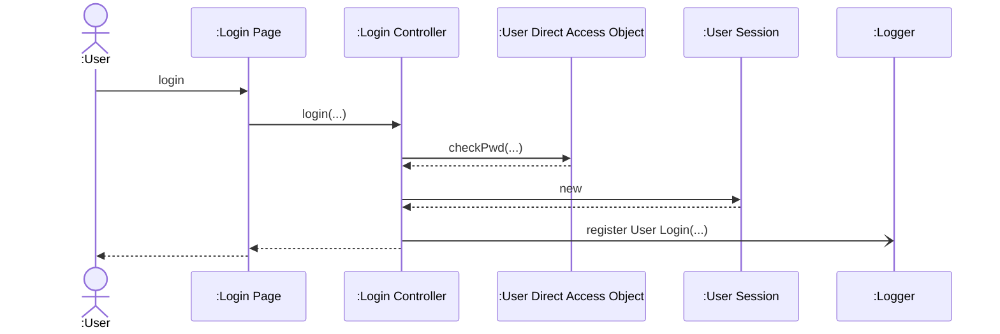
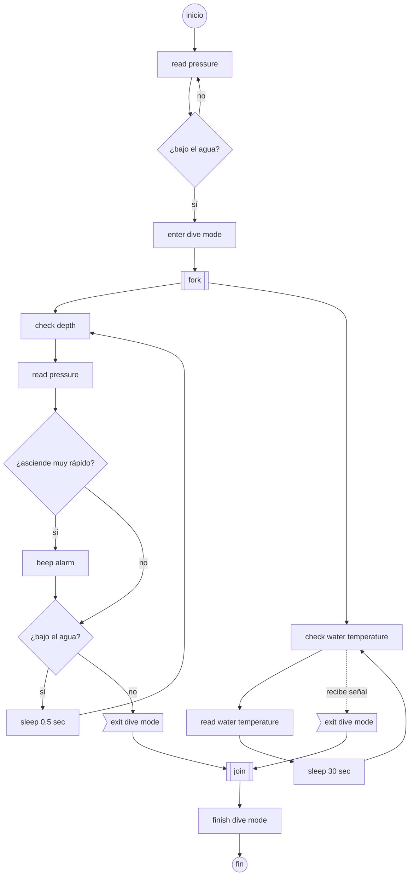
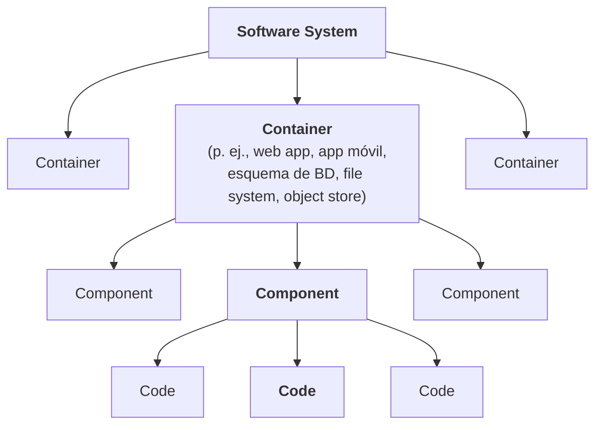
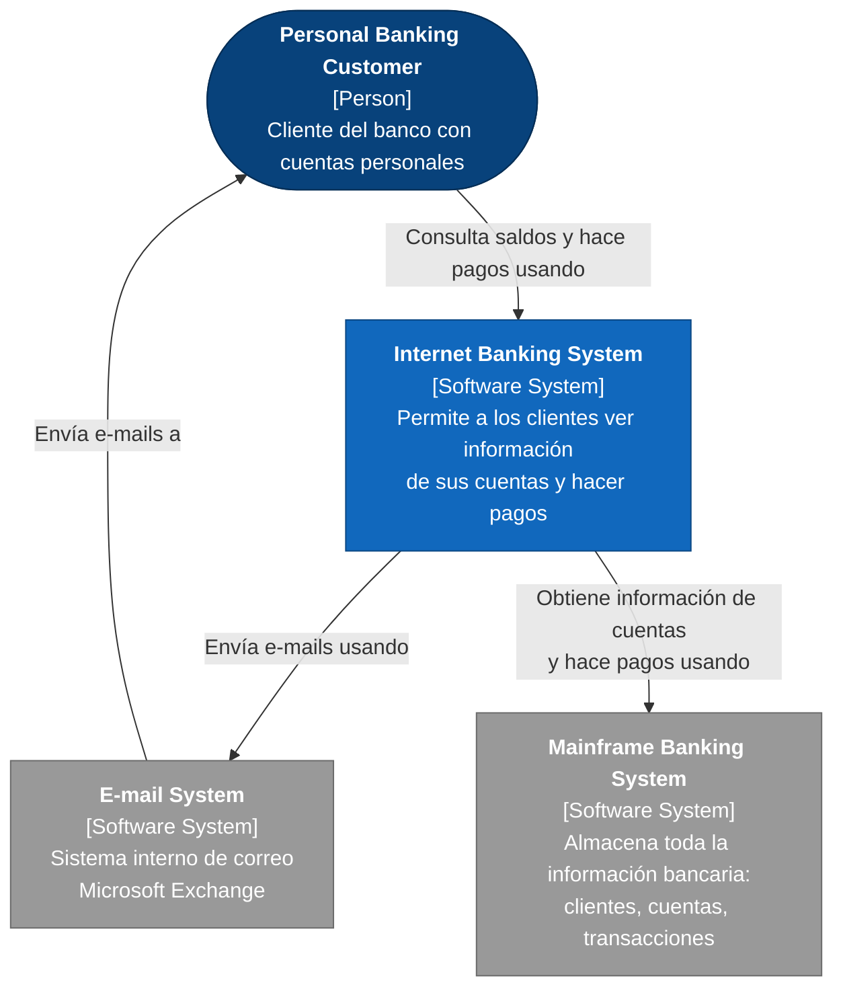
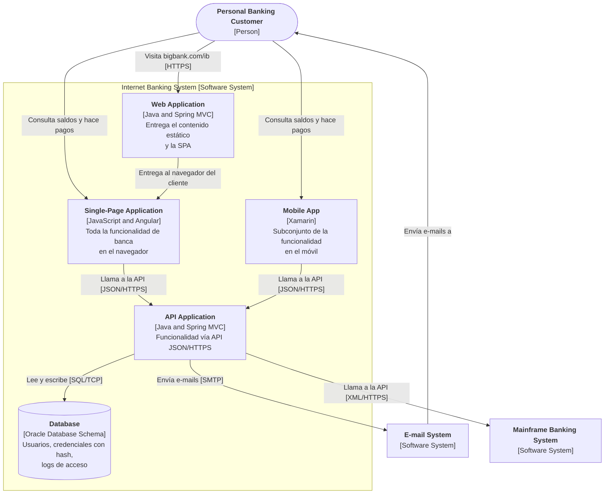
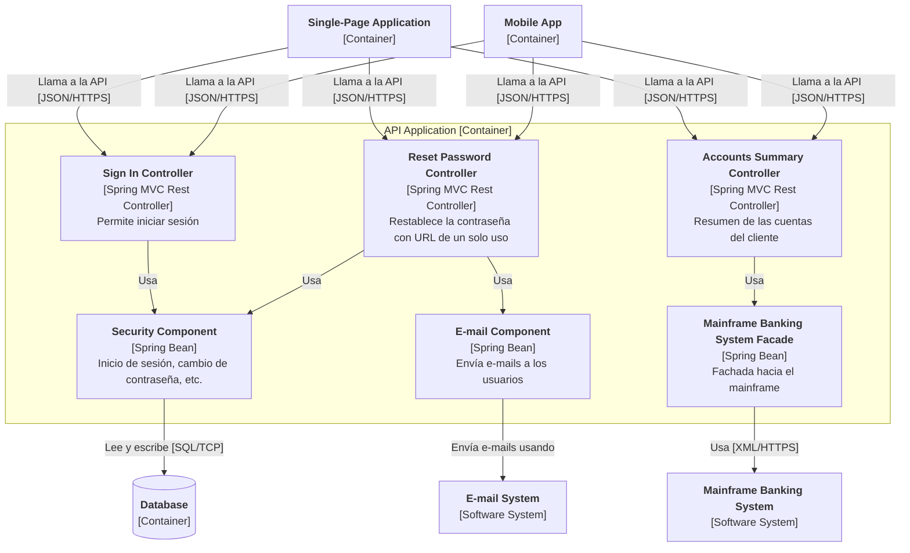
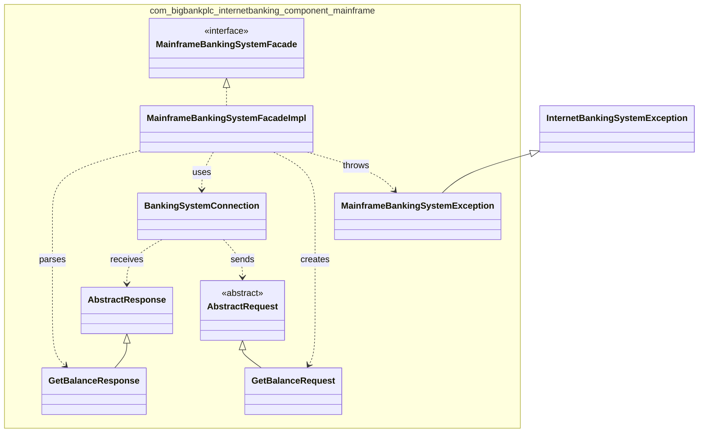
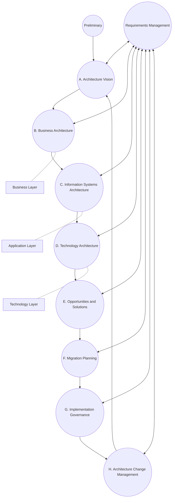
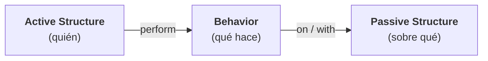
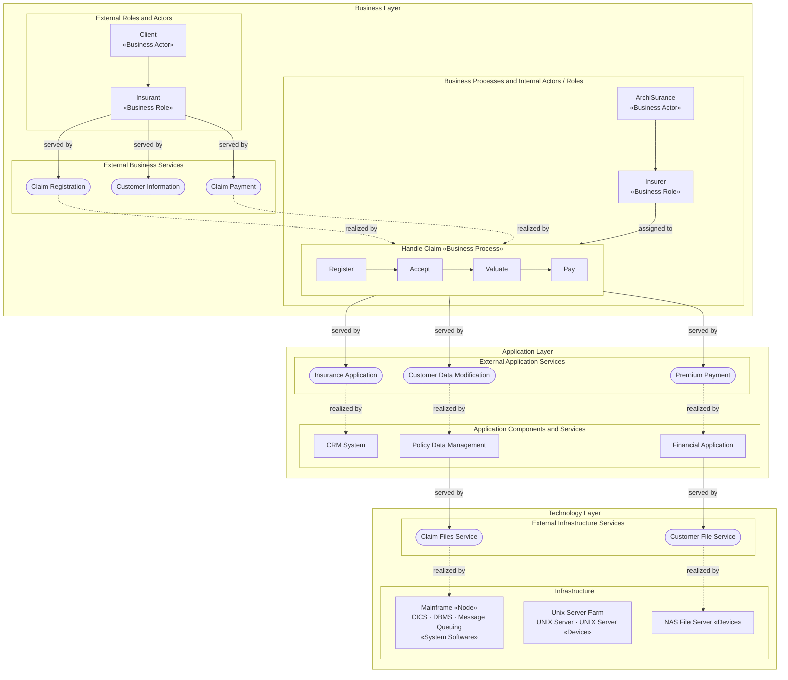

# Técnicas de Diagramación

> Anexo del [Módulo 3](./Modulo-3.md) — Presentación.

## Introducción

Al describir visualmente una arquitectura, el arquitecto a menudo debe mostrar diferentes **vistas**. Por ejemplo, es probable que muestre primero una descripción general de toda la topología de la arquitectura y luego profundice en las partes individuales para entrar en los detalles del diseño. Sin embargo, si muestra una parte sin indicar dónde se ubica dentro de la arquitectura general, confunde a quienes la ven.

> ***Consistencia representacional:*** la práctica de mostrar siempre la relación entre las partes de una arquitectura, ya sea en diagramas o presentaciones, **antes** de cambiar de vista.

Esta presentación cubre tres estándares de diagramación:

| Estándar | Enfoque | Uso típico |
|---|---|---|
| **UML** | Estructura y comportamiento a nivel de software. | Diagramas de secuencia y de clases. |
| **C4** | Vistas del sistema en cuatro niveles de zoom. | Documentar la arquitectura de un sistema de software. |
| **ArchiMate** | Arquitectura empresarial en capas. | Relacionar negocio, aplicaciones y tecnología. |

# UML

## Contexto

El **lenguaje unificado de modelado (UML)** fue un estándar que unificó tres filosofías de diseño que competían en la década de 1980. Se suponía que iba a ser lo mejor de todos los mundos, pero, como muchas cosas diseñadas por comité, no logró mucho impacto fuera de las organizaciones que exigían su uso. Los arquitectos y desarrolladores todavía usan los **diagramas de secuencia** y **de clases** de UML para comunicar estructura y flujo de trabajo, pero la mayoría de los otros tipos de diagramas UML han caído en desuso.

## Documentar el comportamiento

Documentar una arquitectura requiere una **documentación del comportamiento** que complemente las vistas estructurales, describiendo cómo interactúan los elementos de la arquitectura entre sí. Razonar sobre características como el potencial de un sistema para bloquearse (*deadlock*), su capacidad para completar una tarea en el tiempo deseado o su consumo máximo de memoria requiere que la descripción de la arquitectura proporcione información sobre:

- Las características de los elementos individuales y su consumo de recursos.
- Los patrones de interacción entre ellos, es decir, cómo se comportan entre sí.

## Diagrama de secuencia

Un diagrama de secuencia UML muestra una secuencia de interacciones entre instancias de elementos tomados de la documentación estructural. Es útil, al diseñar un sistema, para **identificar dónde se deben definir las interfaces**. Muestra solo las instancias que participan en el escenario que se documenta.

Tiene dos dimensiones:

- **Vertical:** representa el tiempo. Las interacciones se organizan de arriba hacia abajo.
- **Horizontal:** representa las distintas instancias.

**Ejemplo: inicio de sesión**

| Notación | Significado |
|---|---|
| Flecha sólida con punta llena | Mensaje síncrono |
| Flecha sólida con punta abierta | Mensaje asíncrono |
| Flecha punteada | Mensaje de retorno |
| Línea vertical punteada | Línea de vida (*lifeline*) |
| Rectángulo sobre la línea de vida | Ocurrencia de ejecución |

## Diagrama de actividad

Los diagramas de actividad UML son similares a los **diagramas de flujo**. Muestran un proceso de negocio como una secuencia de pasos (llamados **acciones**) e incluyen notación para expresar **ramificación condicional** y **concurrencia**, así como para mostrar eventos de envío y recepción. Las flechas entre acciones indican el flujo de control. Opcionalmente, pueden indicar qué elemento de la arquitectura o qué actor realiza cada acción (mediante carriles o *swimlanes*).

En particular, los diagramas de actividad pueden expresar concurrencia:

- Un **nodo fork** (una barra gruesa perpendicular a las flechas) divide el flujo en dos o más flujos concurrentes.
- Un **nodo join** (también una barra perpendicular) sincroniza esos flujos en uno solo. El join espera a que todos los flujos entrantes terminen antes de continuar.

**Ejemplo: rastreador de buceo (Depth Meter / Dive Tracker / Thermometer)**

> En el diagrama original, los pasos están organizados en tres carriles: **Depth Meter**, **Dive Tracker** y **Thermometer**. El monitoreo de profundidad y el de temperatura corren en paralelo entre el *fork* y el *join*.

# C4

## Definición

**C4** es una técnica de diagramación desarrollada por **Simon Brown** para abordar las deficiencias de UML y modernizar su enfoque. Las cuatro C de C4 son:

| Nivel | Vista | Descripción |
|---|---|---|
| 1 | **Contexto (*Context*)** | Representa todo el contexto del sistema, incluidos los roles de los usuarios y las dependencias externas. |
| 2 | **Contenedores (*Containers*)** | Los límites y contenedores de despliegue físicos (y a menudo lógicos) dentro de la arquitectura. Es un buen punto de encuentro entre operaciones y arquitectos. |
| 3 | **Componentes (*Components*)** | La vista de componentes del sistema; es la que mejor se alinea con la visión que el arquitecto tiene del sistema. |
| 4 | **Código / Clases (*Code*)** | C4 usa el mismo estilo de diagramas de clases de UML, que son efectivos, por lo que no es necesario reemplazarlos. |

**Notas adicionales (del orador)**

- Si una empresa busca estandarizar una técnica de diagramación, C4 es una buena alternativa.
- Sin embargo, como todas las herramientas de diagramación técnica, no puede expresar todos los tipos de diseño que una arquitectura puede abordar.
- C4 es más adecuado para **arquitecturas monolíticas**, donde las relaciones entre contenedores y componentes pueden diferir, y menos adecuado para **arquitecturas distribuidas**, como los microservicios.

## Jerarquía y niveles de zoom

> Un **sistema de software** está compuesto por uno o más **contenedores** (aplicaciones y almacenes de datos), cada uno de los cuales contiene uno o más **componentes**, que a su vez se implementan mediante uno o más elementos de **código** (clases, interfaces, objetos, funciones, etc.).

Cada nivel es un **"zoom in"** sobre un elemento del nivel anterior: Contexto → Contenedores → Componentes → Código. Esto aplica directamente el principio de **consistencia representacional**: siempre se sabe en qué parte del sistema general se está.

Fuente: [c4model.com](https://c4model.com)

## Ejemplo: Internet Banking System

### Nivel 1 — Contexto

### Nivel 2 — Contenedores

### Nivel 3 — Componentes (API Application)

### Nivel 4 — Código (Mainframe Banking System Facade)

# ArchiMate

## Definición

**ArchiMate** (una amalgama de *Archi*tecture-Ani*mate*) es un **lenguaje de modelado de arquitectura empresarial** de código abierto que apoya la descripción, el análisis y la visualización de la arquitectura dentro de los dominios de negocio y entre ellos. Es un estándar técnico de **The Open Group** y ofrece un lenguaje de modelado más liviano para ecosistemas empresariales.

El objetivo de ArchiMate es ser **"lo más pequeño posible"**, no cubrir todos los escenarios de casos extremos. Por eso se ha convertido en una opción popular entre muchos arquitectos.

## Relación con TOGAF

ArchiMate se usa junto con el ciclo **ADM** (*Architecture Development Method*) de **TOGAF**. Las capas centrales de ArchiMate (*core layers*) corresponden a las fases B, C y D del ciclo:

| Zona del ciclo | Fases |
|---|---|
| **Strategy & Motivation** | Preliminary, A |
| **Core Layers** (ArchiMate) | B → Business Layer, C → Application Layer, D → Technology Layer |
| **Implementation & Migration** | E, F, G, H |

> **Nota:** en la imagen original, la fase D aparece etiquetada como "Business Layer". Es un error de la imagen: la fase D (*Technology Architecture*) corresponde a la **Technology Layer**.

## Capas

El lenguaje núcleo de ArchiMate define una estructura de elementos genéricos y sus relaciones, que pueden especializarse en diferentes capas. Define tres capas:

| Capa | Descripción |
|---|---|
| **Negocio (*Business*)** | Ofrece productos y servicios a clientes externos, que la organización realiza mediante procesos de negocio ejecutados por actores de negocio. |
| **Aplicación (*Application*)** | Soporta la capa de negocio con servicios de aplicación, que son realizados por aplicaciones (software). |
| **Tecnología (*Technology*)** | Ofrece los servicios de infraestructura (procesamiento, almacenamiento, comunicación) necesarios para ejecutar las aplicaciones, realizados por hardware de cómputo y comunicación y por software de sistema. |

> Estas capas son compartidas por otros marcos, el más importante de los cuales es **TOGAF**, aunque TOGAF las llama *Business*, *Information System* (*Application* y *Data*) e *Information Technology*.

## Capas y aspectos

Además de las capas, ArchiMate organiza sus elementos en tres **aspectos**. El resultado es una matriz de capas × aspectos:

| | Estructura pasiva | Comportamiento | Estructura activa |
|---|---|---|---|
| **Business** | | | |
| **Application** | | | |
| **Technology** | | | |

- **Estructura activa:** los elementos que *realizan* el comportamiento (actores, componentes, nodos).
- **Comportamiento:** lo que se *hace* (procesos, funciones, servicios).
- **Estructura pasiva:** los objetos *sobre los que* se actúa (objetos de negocio, objetos de datos, artefactos).

Ejemplo en la capa de aplicación:

| Active Structures | Behavior | Passive Structures |
|---|---|---|
| Application component | Application service | Data object |
| Application interface | Application function | |
| Application collaboration | Application interaction | |

## Elementos por capa

### Elementos de estructuras activas

| Business | Application | Technology |
|---|---|---|
| Business actor | Application component | Node |
| Business role | Application interface | Device |
| Business collaboration | Application collaboration | System software |
| Business interface | | Infrastructure interface |
| Location | | Network |
| | | Communication path |

### Elementos de comportamiento

| Business | Application | Technology |
|---|---|---|
| Business process | Application service | Infrastructure service |
| Business function | Application function | Infrastructure function |
| Business interaction | Application interaction | |
| Business event | | |
| Business service | | |

### Elementos de estructuras pasivas

| Business | Application | Technology |
|---|---|---|
| Business object | Data object | Artifact |
| Representation | | |
| Meaning | | |
| Value | | |
| Product | | |
| Contract | | |

> **Colores convencionales:** amarillo para la capa de negocio, azul claro para la capa de aplicación y verde para la capa de tecnología.

## Ejemplo: manejo de reclamaciones de una aseguradora

> Diagrama simplificado del original: se leen de arriba hacia abajo las relaciones "*served by*" (la capa inferior presta servicios a la superior) y "*realized by*" (un elemento concreto realiza un servicio).

Este ejemplo muestra los principales tipos de relación de ArchiMate:

| Relación | Significado |
|---|---|
| **Serving** | Un elemento presta un servicio a otro. |
| **Realization** | Un elemento concreto realiza uno más abstracto (p. ej., un proceso realiza un servicio). |
| **Assignment** | Asigna un actor o rol a un comportamiento. |
| **Triggering** | Un comportamiento dispara el siguiente (p. ej., Register → Accept). |

# Herramientas

[softwarearchitecture.tools](https://softwarearchitecture.tools/) reúne las mejores herramientas, gratuitas y de pago, para diagramar y diseñar arquitecturas de software.

**Modelling tools:** permiten reutilizar y sincronizar objetos entre múltiples vistas, a veces en diferentes niveles de abstracción y con validación estricta. Son ideales para documentación de larga duración.

| Herramienta | Descripción |
|---|---|
| **IcePanel** | Modelado C4 colaborativo, diseñado para aumentar la confianza del equipo. |
| **Enterprise Architect** | Diagramación y modelado empresarial. |
| **Archi** | Herramienta de código abierto para crear modelos y bocetos en ArchiMate. |
| **Structurizr** | Diagramas C4 y documentación. |
| **Carbide** | Modelado y diagramación visual en C4. |
| **StarUML** | Herramienta de modelado enfocada en UML. |
| **Aplas** | Visibilidad del panorama de software. |
| **GenMyModel** | Herramienta de modelado colaborativa. |
| **Gaphor** | Herramienta de modelado de código abierto. |
| **Hackolade** | Diseño visual de esquemas para almacenamiento e intercambio de datos. |
| **Visual Paradigm** | Herramienta de modelado colaborativa en línea. |
| **Archipeg** | Herramienta combinada de arquitectura empresarial y de soluciones. |

# Bibliografía

Mark Richards, Neal Ford. *Fundamentals of Software Architecture: An Engineering Approach*. O'Reilly, 2020.